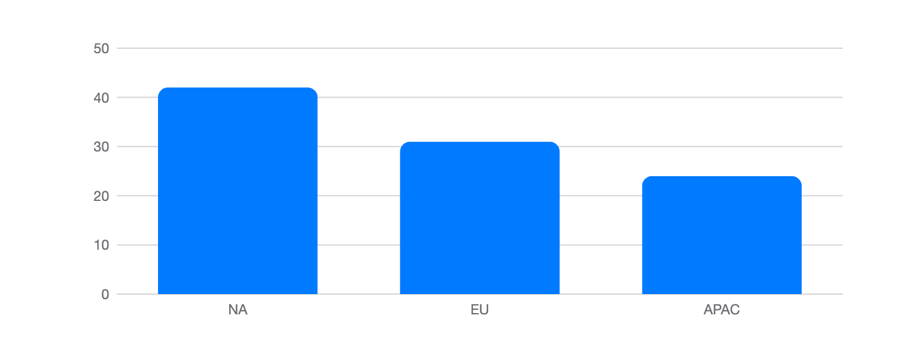

# ChartKit

Charts an agent can write and a server can render.

A chart is one JSON spec. `validate()` and `repair()` check and fix it locally, with no model call and no hosted service. The same spec draws as SVG in React, Vue, Svelte, Solid, Qwik, Angular, Astro, plain DOM, or Node.



```js
import { render } from "@chartkitdev/core/all";

const svg = render({
  version: "1",
  type: "bar",
  data: [{ region: "NA", revenue: 42 }, { region: "EU", revenue: 31 }, { region: "APAC", revenue: 24 }],
  encoding: { x: "region", y: "revenue" },
  a11y: { alt: "North America leads Q3 revenue at $42M." },
});
```

`svg` is a string. It needs no browser, so the same call works in Node, in a build step, or in an edge worker.

```bash
npm install @chartkitdev/core
```

## Why use it

- **It renders on the server, fast.** A 48-bar chart takes 0.26 ms in Node. ECharts takes 5.45 ms, Observable Plot 2.26 ms and Vega-Lite 8.47 ms. No library we measured was faster on the same chart.
- **Agents write less to get a working chart.** A spec is shorter than chart code, so it costs fewer output tokens on every model we tested. When a spec is wrong, `repair()` fixes it without asking the model again.
- **One spec, every stack.** Nine adapters draw the same JSON, and each one prints the SVG on the server. Core has zero runtime dependencies.

A line chart is 32 KB gzip. uPlot is smaller at 24 KB. We publish the benchmarks we lose as well as the ones we win: [BENCHMARKS.md](BENCHMARKS.md).

**Nothing to install:** ChartKit Cloud does the same render over HTTP. Send a spec to `/render` and get an SVG or PNG back. Agents can call its remote MCP, which has one tool, `render_chart`. It goes live at `cloud.chartkit.dev` with v1. The service is in [apps/cloud](apps/cloud/README.md).

**[Docs](https://chartkit.dev/docs)** | **[Gallery](https://chartkit.dev/gallery)** | **[Playground](https://chartkit.dev/playground)** | **[Compare](https://chartkit.dev/compare)** | **[Schema](https://chartkit.dev/schema/v1.json)** | **[Roadmap](ROADMAP.md)** | **[llms.txt](catalog/public/llms.txt)**

## Use it in your framework

Every adapter takes the same spec and adds no chart options of its own.

**React**

```bash
npm install @chartkitdev/core @chartkitdev/react
```

```tsx
import { Chart } from "@chartkitdev/react";

function Panel({ spec }) {
  return <Chart spec={spec} />;
}
```

**Plain JavaScript and Node**

```bash
npm install @chartkitdev/core @chartkitdev/vanilla
```

```js
import { mount, renderToString } from "@chartkitdev/vanilla";

const svg = renderToString(spec); // on the server

const chart = mount(document.querySelector("#chart"), spec); // in the browser
chart.update(nextSpec);
chart.destroy();
```

**Vue**

```bash
npm install @chartkitdev/core @chartkitdev/vue
```

```vue
<script setup>
import { Chart } from "@chartkitdev/vue";
</script>

<template>
  <Chart :spec="spec" />
</template>
```

**Svelte**

```bash
npm install @chartkitdev/core @chartkitdev/svelte
```

```svelte
<script>
  import { Chart } from "@chartkitdev/svelte";
  export let spec;
</script>

<Chart {spec} />
```

The component compiles in Svelte 4 and Svelte 5.

<details>
<summary><b>More frameworks:</b> Astro, Solid, Qwik, Angular and the <code>&lt;chart-kit&gt;</code> element</summary>

**Astro** (`@chartkitdev/astro`)

```astro
---
import { Chart } from "@chartkitdev/astro";
---

<Chart spec={spec} />
```

The chart is static SVG with no client script. The build fails on an invalid spec. Add the `client` prop for tooltips and selection.

**Solid** (`@chartkitdev/solid`)

```tsx
import { Chart } from "@chartkitdev/solid";

export function Panel() {
  return <Chart spec={spec} />;
}
```

**Qwik** (`@chartkitdev/qwik`)

```tsx
import { component$ } from "@builder.io/qwik";
import { Chart } from "@chartkitdev/qwik";

export const Panel = component$(() => <Chart spec={spec} />);
```

**Angular** (`@chartkitdev/angular`)

```ts
import { Component } from "@angular/core";
import { Chart } from "@chartkitdev/angular";

@Component({
  standalone: true,
  imports: [Chart],
  template: `<ck-chart [spec]="spec" />`,
})
export class Panel {
  spec = spec;
}
```

**Custom element** (`@chartkitdev/element`)

```html
<script type="module">
  import "@chartkitdev/element";
</script>

<chart-kit>
  <script type="application/json">
    {"version":"1","type":"line","data":[{"week":"W1","baskets":12},{"week":"W4","baskets":22}],"encoding":{"x":"week","y":"baskets"},"a11y":{"alt":"Baskets rose."}}
  </script>
</chart-kit>
```

Each of these also prints the SVG during server rendering. Their READMEs are in [packages/](packages).

</details>

By default an adapter can draw every chart type. To ship one type, pass `render` from `createRenderer([...])`.

## Validate and repair

```js
import { repair, validate } from "@chartkitdev/core/validate";

const draft = {
  version: 1,
  type: "line",
  data: { values: [{ month: "Jan", sales: 3 }, { month: "Feb", sales: 5 }] },
  encoding: { x: "month", y: "sales" },
};

validate(draft).ok; // false
const fixed = repair(draft);
fixed.ok; // true
fixed.applied; // the JSON Patch operations it made
```

`validate()` returns coded diagnostics (`CK1003` and so on), and each one carries a JSON Patch fix where a fix is safe. `repair()` applies those fixes. Both are deterministic and run in your process. `repairAsync()` from `@chartkitdev/core/validate/convert` also converts Chart.js, ECharts, Plotly, Vega-Lite and Recharts configs.

In our agent eval, a model with no ChartKit docs got 21 of 42 specs right on its first answer. Recharts, ECharts and Chart.js got all 42. Running `repair()` on ChartKit's answers made all 42 valid, with no second model call. The method and the full results are in [BENCHMARKS.md](BENCHMARKS.md#agent-first-try-eval).

For agents:

- [llms.txt](catalog/public/llms.txt) is the short spec reference, with an example for most chart types.
- `npx -y @chartkitdev/mcp` is a local MCP server with `validate`, `repair` and `render` tools. See [packages/mcp](packages/mcp/README.md).

## The spec

```json
{
  "version": "1",
  "type": "line",
  "data": [
    { "quarter": "Q1", "units": 40 },
    { "quarter": "Q2", "units": 55 }
  ],
  "encoding": { "x": "quarter", "y": "units" },
  "a11y": { "alt": "Units rose from Q1 to Q2." }
}
```

- `version` is `"1"`.
- `type` is the chart type.
- `data` is a plain array of rows.
- `encoding` maps fields to `x`, `y`, `color` and the other channels.
- `a11y.alt` is one sentence that says what the chart shows. It is required.

The site catalog has 41 types: the 39 ids in `apps/web/src/data/chart-types.ts`, plus choropleth and point maps from `@chartkitdev/geo`. [packages/core/README.md](packages/core/README.md) has one working spec for each core type and the full rules. [packages/core/SPEC.md](packages/core/SPEC.md) is the reference.

An option either draws or returns a warning that says why it did not.

## What it does not do

- **Millions of raw points.** There is no WebGL renderer and none is planned. Lines are sampled to the pixel width, which is how a 1M-point line draws in about 24 ms. To draw and interact with every one of millions of points, use a GPU library such as [SciChart](https://www.scichart.com) or [LightningChart](https://lightningchart.com).
- **The smallest bundle.** uPlot is smaller for line, bar, scatter and mini-area charts. A single ChartKit chart type is 6.7 to 38 KB gzip, and every core chart together is 78 KB.
- **Every chart type.** There is no network graph, chord, violin, parallel coordinates or 3D.

## Interaction and accessibility

Tooltips, zoom, pan, brush, selection, a navigator, synced charts and drilldown run in the browser from `@chartkitdev/core/interact`. Server output is the static SVG.

Every chart requires alt text, and the validator enforces it. Keyboard navigation and a hidden data table are opt-in today (`a11y.keyboard` and `a11y.dataTable`). They are set to become the default for client renders in v1.

## Themes

The default theme is Soft. It follows the page's light or dark scheme and has a transparent background. `refined`, `editorial` and `midnight` are built in. More presets are opt-in imports from `@chartkitdev/core/themes/<name>`:

- **Dark:** `emerald`, `mono`, `slate`, `arctic`, `orchid`, `obsidian`, `neon`, `mocha`, `owl`, `retro`, `copper`, `rose`
- **Light:** `sunset`, `silver`, `pearl`, `latte`
- **Also:** `tape`, `kite`, `mustard`, `violet`

For a brand colour, `paletteFromBrand("#635bff")` from `@chartkitdev/core/themes/brand` returns a series palette for `theme.tokens.series`.

## Packages

| Package | What it is |
| --- | --- |
| `@chartkitdev/core` | The spec, `validate()`, `repair()` and the SVG renderer. Zero runtime dependencies. |
| `@chartkitdev/react`, `vue`, `svelte`, `astro`, `solid`, `qwik`, `angular` | Framework adapters. |
| `@chartkitdev/vanilla` | `mount()` and `renderToString()` for plain DOM and Node. |
| `@chartkitdev/element` | The `<chart-kit>` custom element. |
| `@chartkitdev/geo` | Choropleth and point maps. Each atlas is its own chunk. There is no tile layer. |
| `@chartkitdev/markdown` | remark and rehype plugins that turn `chartkit` fences into SVG. |
| `@chartkitdev/mcp` | The local MCP server. |

`@chartkitdev/convert` is private and powers the converter on the website.

## Coming from v0

The older prop-based React components (`LineChart`, `KpiCard` and the rest) and the `@derpdaderp/chartkit` package are frozen. See [Upgrading from v0](catalog/migrate.md).

## Benchmarks

[BENCHMARKS.md](BENCHMARKS.md) has every table: bundle size, browser paint, updates, hover, server render and the agent eval, with the losses and the JSON files each number comes from. The raw results are in [bench/results](bench/results). `npm run bench` reproduces them.

## Working on this repo

```bash
npm install
npm run build:lib
npm test
npm run dev
```

`npm run dev` starts the site in [apps/web](apps/web/README.md) at http://localhost:4321. It needs Node 22.23.4 or newer. The libraries support Node 20. [catalog/](catalog) holds `llms.txt`, the feature matrix and the published benchmark data. Releases are described in [RELEASING.md](RELEASING.md), and merging does not deploy chartkit.dev.

## Author

Created by [@toddo](https://x.com/toddo), founder of [BuySellAds](https://buysellads.com).

## License

MIT
