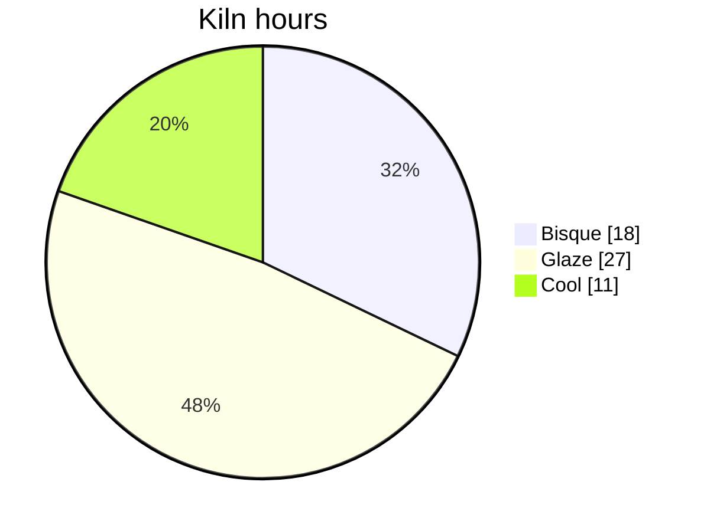
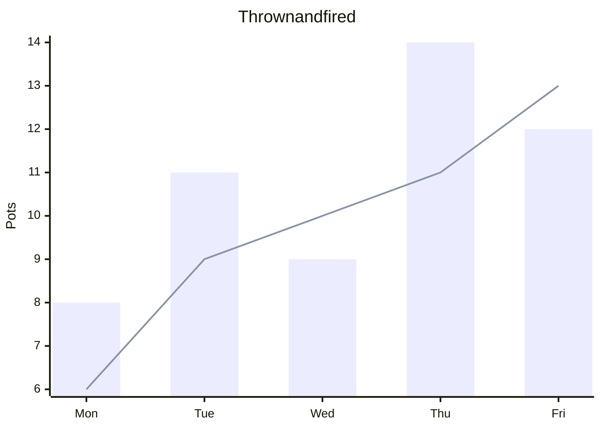
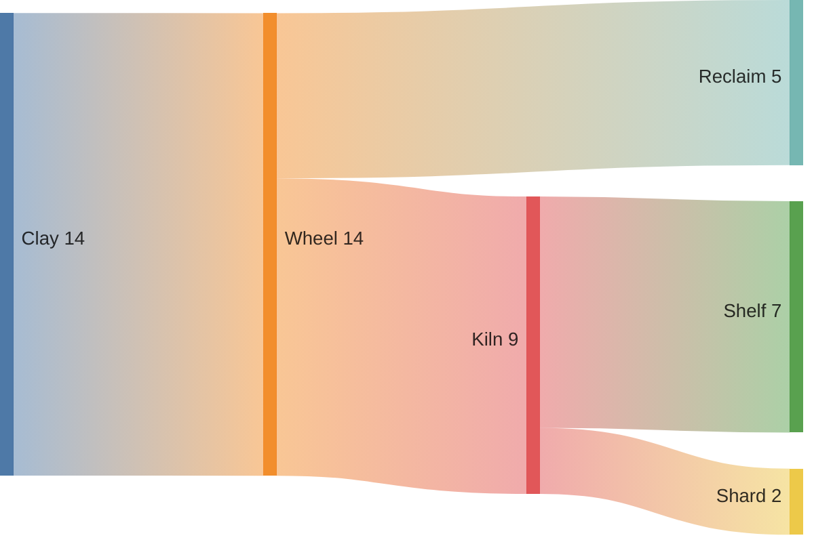
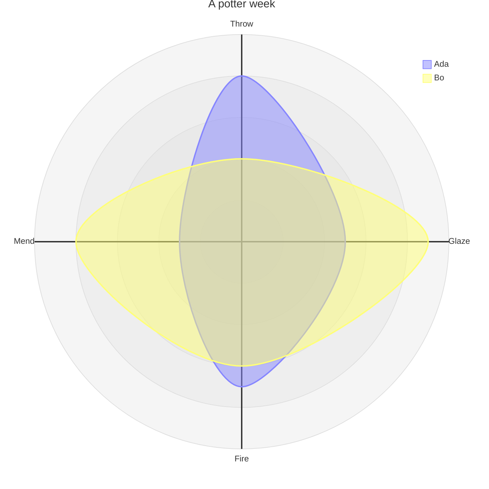
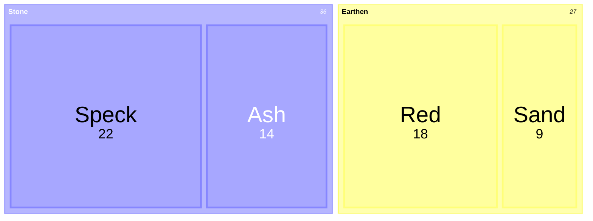
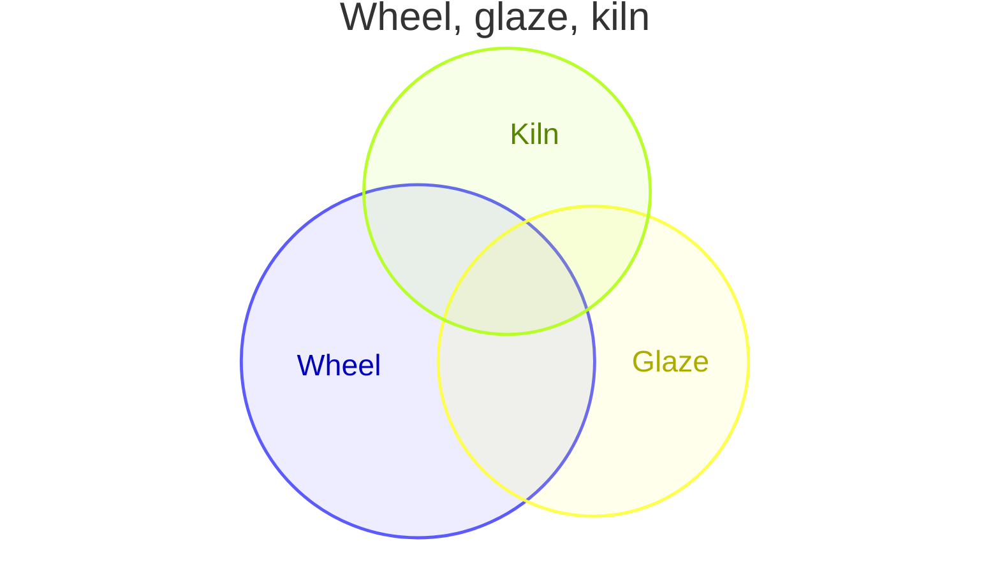

# Mermaid sheet

Six fences the game-launch board does not show: pie, xychart, sankey, radar, treemap, and venn. Each card is new pottery data.

## Kiln hours

A pie fence. showData puts the numbers in the legend.



```json
{
  "version": "1",
  "type": "pie",
  "data": [
    {
      "label": "Bisque",
      "value": 18
    },
    {
      "label": "Glaze",
      "value": 27
    },
    {
      "label": "Cool",
      "value": 11
    }
  ],
  "encoding": {
    "x": "label",
    "y": "value"
  },
  "a11y": {
    "alt": "Kiln hours"
  },
  "title": "Kiln hours",
  "legend": {
    "values": true
  },
  "theme": "soft",
  "size": {
    "width": 520,
    "height": 460
  }
}
```

## Thrown and fired

An xychart fence becomes a combo.



```json
{
  "version": "1",
  "type": "combo",
  "data": [
    {
      "x": "Mon",
      "thrown": 8,
      "fired": 6
    },
    {
      "x": "Tue",
      "thrown": 11,
      "fired": 9
    },
    {
      "x": "Wed",
      "thrown": 9,
      "fired": 10
    },
    {
      "x": "Thu",
      "thrown": 14,
      "fired": 11
    },
    {
      "x": "Fri",
      "thrown": 12,
      "fired": 13
    }
  ],
  "encoding": {
    "x": "x",
    "y": [
      {
        "field": "thrown",
        "title": "Thrown",
        "mark": "bar"
      },
      {
        "field": "fired",
        "title": "Fired",
        "mark": "line"
      }
    ]
  },
  "a11y": {
    "alt": "Thrown and fired"
  },
  "title": "Thrown and fired",
  "axes": {
    "y": {
      "title": "Pots"
    }
  },
  "theme": "soft",
  "size": {
    "width": 880,
    "height": 440
  }
}
```

## Clay to the shelf

A sankey fence. The return is not in this one.



```json
{
  "version": "1",
  "type": "sankey",
  "data": [
    {
      "from": "Clay",
      "to": "Wheel",
      "flow": 14
    },
    {
      "from": "Wheel",
      "to": "Kiln",
      "flow": 9
    },
    {
      "from": "Wheel",
      "to": "Reclaim",
      "flow": 5
    },
    {
      "from": "Kiln",
      "to": "Shelf",
      "flow": 7
    },
    {
      "from": "Kiln",
      "to": "Shard",
      "flow": 2
    }
  ],
  "encoding": {
    "source": "from",
    "target": "to",
    "y": "flow"
  },
  "a11y": {
    "alt": "The largest flow is Clay to Wheel at 14."
  },
  "theme": "soft",
  "size": {
    "width": 880,
    "height": 480
  }
}
```

## A potter's week

Two curves, with a max of 10.



```json
{
  "version": "1",
  "type": "radar",
  "data": [
    {
      "spoke": "Throw",
      "series": "Ada",
      "value": 8
    },
    {
      "spoke": "Glaze",
      "series": "Ada",
      "value": 5
    },
    {
      "spoke": "Fire",
      "series": "Ada",
      "value": 7
    },
    {
      "spoke": "Mend",
      "series": "Ada",
      "value": 3
    },
    {
      "spoke": "Throw",
      "series": "Bo",
      "value": 4
    },
    {
      "spoke": "Glaze",
      "series": "Bo",
      "value": 9
    },
    {
      "spoke": "Fire",
      "series": "Bo",
      "value": 6
    },
    {
      "spoke": "Mend",
      "series": "Bo",
      "value": 8
    }
  ],
  "encoding": {
    "x": "spoke",
    "y": {
      "field": "value",
      "scale": {
        "domain": [
          0,
          10
        ]
      }
    },
    "series": "series"
  },
  "a11y": {
    "alt": "A potter week"
  },
  "title": "A potter week",
  "theme": "soft",
  "size": {
    "width": 880,
    "height": 440
  }
}
```

## Clay on the rack

A treemap fence, two families.



```json
{
  "version": "1",
  "type": "treemap",
  "data": [
    {
      "name": "Speck",
      "size": 22,
      "group": "Stone"
    },
    {
      "name": "Ash",
      "size": 14,
      "group": "Stone"
    },
    {
      "name": "Red",
      "size": 18,
      "group": "Earthen"
    },
    {
      "name": "Sand",
      "size": 9,
      "group": "Earthen"
    }
  ],
  "encoding": {
    "x": "name",
    "y": "size",
    "color": "group"
  },
  "a11y": {
    "alt": "Speck is the largest block at 22."
  },
  "theme": "soft",
  "size": {
    "width": 880,
    "height": 440
  }
}
```

## Wheel, glaze, kiln

A venn fence. Overlaps are approximate.



```json
{
  "version": "1",
  "type": "venn",
  "data": [
    {
      "set": "Wheel",
      "size": 70
    },
    {
      "set": "Glaze",
      "size": 54
    },
    {
      "set": "Kiln",
      "size": 46
    },
    {
      "set": "Wheel+Glaze",
      "size": 22
    },
    {
      "set": "Wheel+Kiln",
      "size": 16
    },
    {
      "set": "Glaze+Kiln",
      "size": 12
    },
    {
      "set": "Wheel+Glaze+Kiln",
      "size": 8
    }
  ],
  "a11y": {
    "alt": "Wheel, glaze, kiln"
  },
  "title": "Wheel, glaze, kiln",
  "theme": "soft",
  "size": {
    "width": 880,
    "height": 480
  }
}
```

## Options used

- [Accessible name / alt text](https://chartkit.dev/features/a11y.alt) (`a11y.alt`)
- [Axis title](https://chartkit.dev/features/axis.title) (`axis.title`)
- [Values in legend](https://chartkit.dev/features/legend.values) (`legend.values`)
- [Explicit domain (min/max)](https://chartkit.dev/features/scale.domain) (`scale.domain`)
- [Built-in themes](https://chartkit.dev/features/theme.presets) (`theme.presets`)
- [Combined bar + line](https://chartkit.dev/features/type.combo) (`type.combo`)
- [Pie chart](https://chartkit.dev/features/type.pie) (`type.pie`)
- [Radar / spider chart](https://chartkit.dev/features/type.radar) (`type.radar`)
- [Sankey](https://chartkit.dev/features/type.sankey) (`type.sankey`)
- [Treemap](https://chartkit.dev/features/type.treemap) (`type.treemap`)
- [Venn / Euler diagram](https://chartkit.dev/features/type.venn) (`type.venn`)
- [Text-syntax charts (Mermaid-style)](https://chartkit.dev/features/type.xychart.text) (`type.xychart.text`)

https://chartkit.dev/showcase/mermaid-sheet
