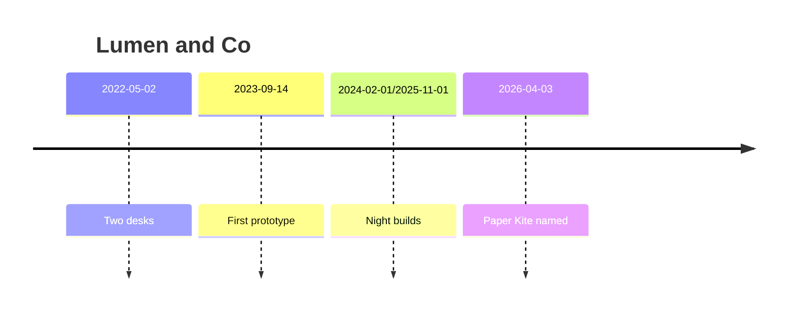
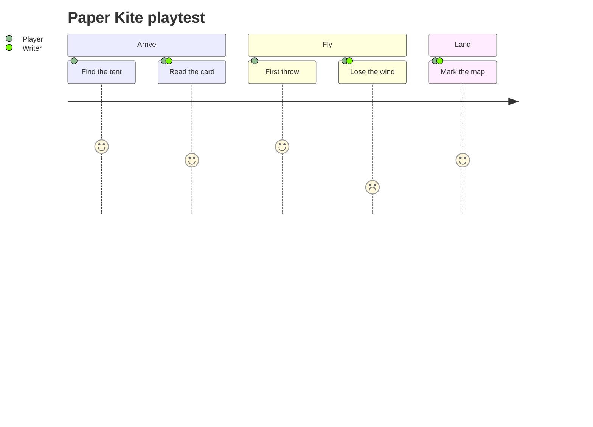
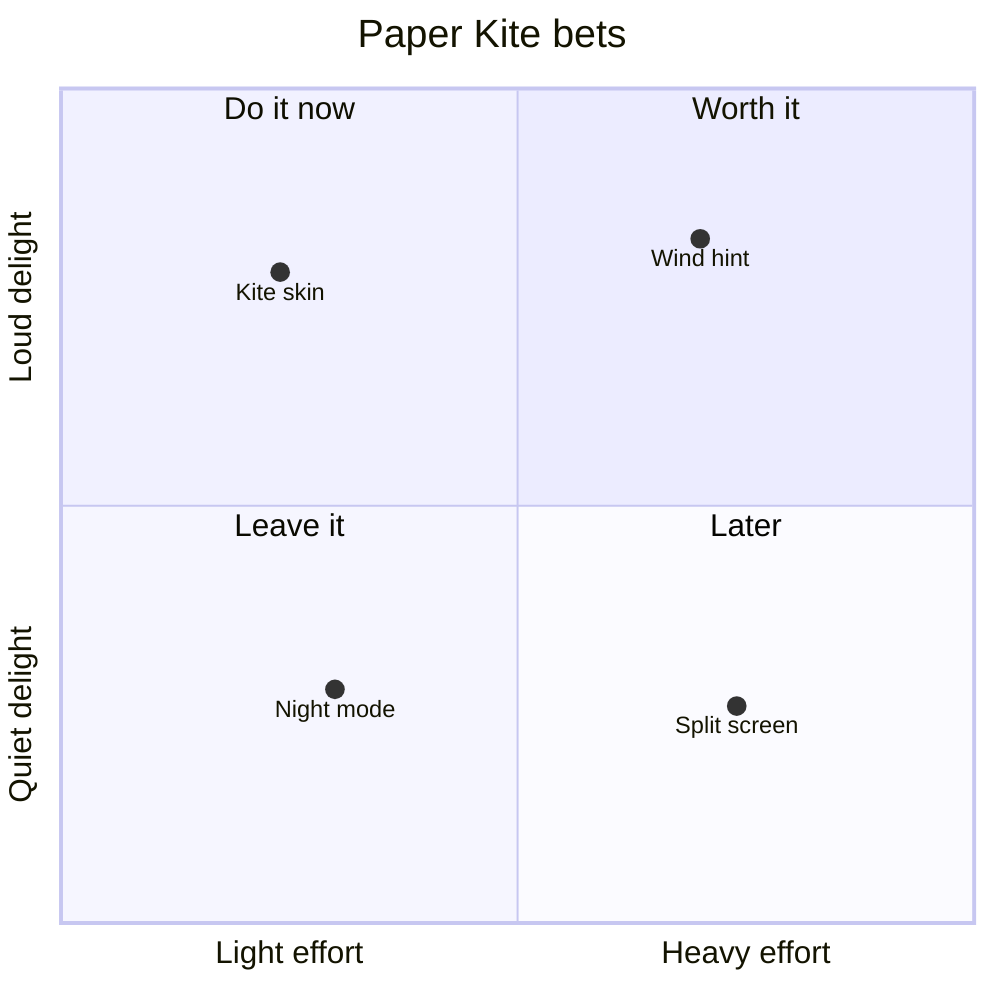

# Indie game launch, from Mermaid

A two-person studio shipping a game called Paper Kite. The Mermaid on the left is what fromMermaid reads. The chart on the right is the spec it returns, checked with validatePhase4.

## Launch lanes

A gantt with sections, a done lane, and a milestone.

```mermaid
gantt
    title Paper Kite
    dateFormat YYYY-MM-DD
    section Sketch
    Write the beats :done, beats, 2026-06-01, 2026-06-12
    Paint the kite :active, kite, 2026-06-08, 2026-06-26
    section Build
    Tune the glide :active, glide, after kite, 2026-06-22, 2026-07-10
    section Ship
    First flight :milestone, flight, after glide, 2026-07-17, 0d
```

```json
{
  "version": "1",
  "type": "gantt",
  "data": [
    {
      "task": "Write the beats",
      "section": "Sketch",
      "id": "beats",
      "start": "2026-06-01",
      "end": "2026-06-12",
      "status": "done"
    },
    {
      "task": "Paint the kite",
      "section": "Sketch",
      "id": "kite",
      "start": "2026-06-08",
      "end": "2026-06-26",
      "status": "active"
    },
    {
      "task": "Tune the glide",
      "section": "Build",
      "id": "glide",
      "start": "2026-06-22",
      "end": "2026-07-10",
      "status": "active",
      "depends": "kite"
    },
    {
      "task": "First flight",
      "section": "Ship",
      "id": "flight",
      "start": "2026-07-17",
      "milestone": true,
      "depends": "glide"
    }
  ],
  "a11y": {
    "alt": "Paper Kite"
  },
  "title": "Paper Kite",
  "theme": "soft",
  "size": {
    "width": 720,
    "height": 340
  }
}
```

## Studio years

Events and one era span.



```json
{
  "version": "1",
  "type": "timeline",
  "data": [
    {
      "label": "Two desks",
      "date": "2022-05-02"
    },
    {
      "label": "First prototype",
      "date": "2023-09-14"
    },
    {
      "label": "Night builds",
      "start": "2024-02-01",
      "end": "2025-11-01"
    },
    {
      "label": "Paper Kite named",
      "date": "2026-04-03"
    }
  ],
  "a11y": {
    "alt": "Lumen and Co"
  },
  "title": "Lumen and Co",
  "theme": "soft",
  "size": {
    "width": 720,
    "height": 340
  }
}
```

## Playtest journey

Scores from 1 to 5, with who was in the room.



```json
{
  "version": "1",
  "type": "journey",
  "data": [
    {
      "step": "Find the tent",
      "score": 5,
      "section": "Arrive",
      "actors": "Player"
    },
    {
      "step": "Read the card",
      "score": 4,
      "section": "Arrive",
      "actors": "Player, Writer"
    },
    {
      "step": "First throw",
      "score": 5,
      "section": "Fly",
      "actors": "Player"
    },
    {
      "step": "Lose the wind",
      "score": 2,
      "section": "Fly",
      "actors": "Player, Writer"
    },
    {
      "step": "Mark the map",
      "score": 4,
      "section": "Land",
      "actors": "Player, Writer"
    }
  ],
  "a11y": {
    "alt": "Paper Kite playtest"
  },
  "title": "Paper Kite playtest",
  "theme": "soft",
  "size": {
    "width": 720,
    "height": 340
  }
}
```

## What to build next

Effort across, delight up. Names stay on the points.



```json
{
  "version": "1",
  "type": "quadrant",
  "data": [
    {
      "name": "Kite skin",
      "x": 0.24,
      "y": 0.78
    },
    {
      "name": "Wind hint",
      "x": 0.7,
      "y": 0.82
    },
    {
      "name": "Night mode",
      "x": 0.3,
      "y": 0.28
    },
    {
      "name": "Split screen",
      "x": 0.74,
      "y": 0.26
    }
  ],
  "encoding": {
    "x": {
      "field": "x",
      "title": "Light effort|Heavy effort"
    },
    "y": {
      "field": "y",
      "title": "Quiet delight|Loud delight"
    }
  },
  "a11y": {
    "alt": "Paper Kite bets"
  },
  "quadrants": [
    "Do it now",
    "Worth it",
    "Leave it",
    "Later"
  ],
  "title": "Paper Kite bets",
  "theme": "soft",
  "size": {
    "width": 720,
    "height": 340
  }
}
```

## Options used

- [Accessible name / alt text](https://chartkit.dev/features/a11y.alt) (`a11y.alt`)
- [Built-in themes](https://chartkit.dev/features/theme.presets) (`theme.presets`)
- [Gantt](https://chartkit.dev/features/type.gantt) (`type.gantt`)
- [User journey](https://chartkit.dev/features/type.journey) (`type.journey`)
- [Quadrant chart](https://chartkit.dev/features/type.quadrant) (`type.quadrant`)
- [Timeline / event chart](https://chartkit.dev/features/type.timeline) (`type.timeline`)
- [Text-syntax charts (Mermaid-style)](https://chartkit.dev/features/type.xychart.text) (`type.xychart.text`)
- [Runtime spec validation API](https://chartkit.dev/features/validate.runtime) (`validate.runtime`)

https://chartkit.dev/showcase/game-launch
