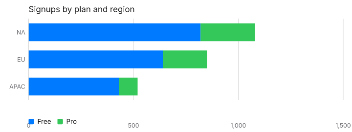
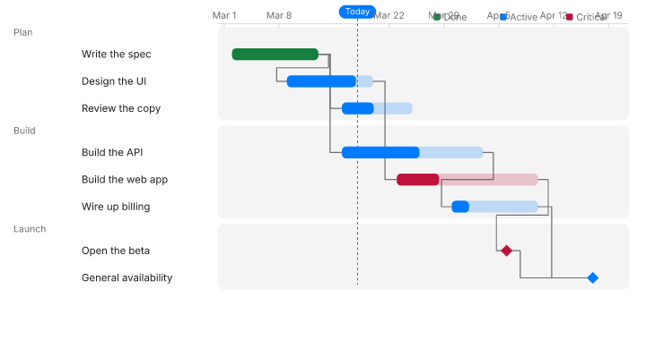

# Chart render sweep

Seed `20261105`. Mode `full`. 29372 cases, 22046 rendered, 205.6s.

ChartKit does not rewrite or shorten labels. An overlap is a layout bug. Spec-set sizes are left as the example wrote them, except when the sweep itself sets `size`.

## Snapshots

Wrote the dHash baseline for this mode. Baselines are 64-bit hashes at raster width 96, not PNGs. A full sweep is about twenty thousand renders. Committing every PNG would add tens of megabytes. The hash catches a changed picture and stays small. Flagged renders are written under scripts/render-harness/out/png, and a few display-sized frames are copied into report/examples.

Compared 21431. Changed 0. Missing baseline 0. Tolerance 8 bits on a 64-bit dHash.

## Timing

Render p50 0.2 ms, p95 2.5 ms, max 58807.5 ms.

## Findings by check

| Check | Count |
| --- | ---: |
| contrast | 5231 |
| text-outside | 4887 |
| text-overlap | 2207 |
| mark-outside | 758 |
| render-exception | 382 |
| snapshot | 233 |
| legend-overlap | 84 |
| empty-chart | 58 |
| text-clipped | 27 |
| bad-number | 12 |
| render-time | 3 |

## Findings by chart type

| Type | Count |
| --- | ---: |
| bar | 1437 |
| line | 1194 |
| combo | 968 |
| candlestick | 886 |
| scatter | 872 |
| stacked-area | 567 |
| strip | 551 |
| streamgraph | 525 |
| waterfall | 499 |
| area-range | 497 |
| spike | 457 |
| histogram | 391 |
| boxplot | 384 |
| treemap | 384 |
| density | 344 |
| heatmap | 322 |
| bar-range | 311 |
| errorbar | 280 |
| gauge | 277 |
| donut | 244 |
| pie | 208 |
| radar | 204 |
| quadrant | 185 |
| funnel | 182 |
| kpi | 163 |
| gantt | 158 |
| choropleth | 155 |
| journey | 150 |
| timeline | 149 |
| radial-bar | 147 |
| rose | 144 |
| sankey | 111 |
| sunburst | 110 |
| bullet | 91 |
| venn | 80 |
| progress-ring | 74 |
| map-points | 64 |
| tree | 62 |
| bar-list | 31 |
| sparkline | 13 |
| mini-area | 11 |

## Root-cause groups

A group is one check failing the same way. Counts are findings, not chart types.

### 1. contrast · label (3287)

Types: area-range, bar, bar-list, bar-range, boxplot, bullet, candlestick, combo, density, donut, errorbar, funnel, gantt, gauge, heatmap, histogram, journey, kpi, line, pie, progress-ring, quadrant, radar, radial-bar, rose, sankey, scatter, spike, streamgraph, strip, sunburst, timeline, tree, treemap, venn, waterfall

Options: axes.x.offset, axes.y.format.prefix, axes.y.format.suffix, axes.y.offset, axes.y2.format.prefix, axes.y2.format.suffix, encoding.color, encoding.color.value

- `area-range` / `30-area-range` / ``
  Label “today” is 4.02:1 on #ffffff in light mode. Minimum is 4.5:1.
- `area-range` / `30-area-range` / `theme` = "emerald"
  Label “400” is 4.18:1 on #0a0a0a in dark mode. Minimum is 4.5:1.
- `area-range` / `30-area-range` / `theme` = "emerald"
  Label “500” is 4.18:1 on #0a0a0a in dark mode. Minimum is 4.5:1.

### 2. text-outside · label (2881)

Types: area-range, bar, bar-list, bar-range, boxplot, bullet, candlestick, choropleth, combo, density, donut, errorbar, funnel, gantt, gauge, heatmap, histogram, journey, kpi, line, map-points, mini-area, pie, progress-ring, quadrant, radar, radial-bar, rose, sankey, scatter, sparkline, spike, stacked-area, streamgraph, strip, sunburst, timeline, tree, treemap, venn, waterfall

Options: axes.x.format, axes.x.format.decimals, axes.x.format.prefix, axes.x.format.signed, axes.x.format.specifier, axes.x.format.suffix, axes.x.offset, axes.x.rotate

- `area-range` / `30-area-range` / `axes.x.offset` = 1000000
  Label “Jan” extends outside the viewBox. ChartKit does not rewrite or shorten labels. Overlap is a layout bug. The spec size wins.
- `area-range` / `30-area-range` / `axes.x.offset` = 1000000
  Label “Feb” extends outside the viewBox. ChartKit does not rewrite or shorten labels. Overlap is a layout bug. The spec size wins.
- `area-range` / `30-area-range` / `axes.x.offset` = 1000000
  Label “Mar” extends outside the viewBox. ChartKit does not rewrite or shorten labels. Overlap is a layout bug. The spec size wins.

### 3. text-overlap · label × label (1393)

Types: area-range, bar, bar-range, boxplot, bullet, candlestick, choropleth, combo, density, donut, errorbar, gantt, gauge, heatmap, histogram, journey, line, map-points, pie, quadrant, radar, rose, sankey, scatter, spike, stacked-area, streamgraph, strip, sunburst, timeline, treemap, venn, waterfall

Options: axes.x.format, axes.x.format.prefix, axes.x.format.suffix, axes.x.offset, axes.x.position, axes.x.rotate, axes.x.titleRotate, axes.y.format

- `area-range` / `30-area-range` / `axes.x.position` = "left"
  Label “Apr” overlaps Label “today”. ChartKit does not rewrite or shorten labels. Overlap is a layout bug. The spec size wins.
- `area-range` / `30-area-range` / `axes.x.position` = "top"
  Label “Apr” overlaps Label “today”. ChartKit does not rewrite or shorten labels. Overlap is a layout bug. The spec size wins.
- `area-range` / `30-area-range` / `axes.y.position` = "right"
  Label “500” overlaps Label “Forecast”. ChartKit does not rewrite or shorten labels. Overlap is a layout bug. The spec size wins.

### 4. text-outside · tick (1303)

Types: area-range, bar, bar-range, boxplot, candlestick, combo, density, donut, errorbar, gantt, gauge, heatmap, histogram, line, progress-ring, radar, rose, scatter, spike, stacked-area, streamgraph, strip, tree, waterfall

Options: axes.x.crosses, axes.x.offset, axes.x.position, axes.x.title, axes.y.format, axes.y.format.decimals, axes.y.format.prefix, axes.y.format.signed

- `area-range` / `30-area-range` / `axes.y.title` = "Northstar launch window label Northstar launch window label Northstar launch window label Northstar launch window label"
  Tick label “Northstar launch window label Northstar launch window label Northstar launch window label Northstar launch window label” extends outside the viewBox. ChartKit does not rewrite or shorten labels. Overlap is a layout bug. The spec size wins.
- `area-range` / `30-area-range` / `encoding.y.title` = "Northstar launch window label Northstar launch window label Northstar launch window label Northstar launch window label"
  Tick label “Northstar launch window label Northstar launch window label Northstar launch window label Northstar launch window label” extends outside the viewBox. ChartKit does not rewrite or shorten labels. Overlap is a layout bug. The spec size wins.
- `area-range` / `30-area-range` / `size.height` = "0"
  Tick label “Jan” extends outside the viewBox. ChartKit does not rewrite or shorten labels. Overlap is a layout bug. The spec size wins.

### 5. contrast · tick (1194)

Types: bar, bar-range, combo, gantt, gauge, heatmap, line, stacked-area, strip, timeline, waterfall

Options: axes.x.offset, axes.y.format.prefix, axes.y.format.suffix, axes.y.offset, axes.y2.format.prefix, axes.y2.format.suffix, axes.y2.offset, encoding.y.axis

- `bar` / `03-bar` / `axes.x.offset` = -80
  Tick label “Jan” is 1.26:1 on #007aff in light mode. Minimum is 4.5:1.
- `bar` / `03-bar` / `axes.x.offset` = -80
  Tick label “Feb” is 1.26:1 on #007aff in light mode. Minimum is 4.5:1.
- `bar` / `03-bar` / `axes.x.offset` = -80
  Tick label “Mar” is 1.26:1 on #007aff in light mode. Minimum is 4.5:1.

### 6. mark-outside (758)

Types: area-range, bar-range, boxplot, bullet, candlestick, density, errorbar, funnel, gantt, gauge, histogram, quadrant, radar, radial-bar, rose, sankey, streamgraph, strip, sunburst, timeline, waterfall

Options: axes.y.format.prefix, axes.y.format.suffix, encoding.close.format.prefix, encoding.close.format.suffix, encoding.high.format.prefix, encoding.high.format.suffix, encoding.open.format.prefix, encoding.open.format.suffix

- `area-range` / `30-area-range` / `axes.y.format.prefix` = "Northstar launch window label Northstar launch window label Northstar launch window label Northstar launch window label"
  Mark band is outside the viewBox.
- `area-range` / `30-area-range` / `axes.y.format.prefix` = "Northstar launch window label Northstar launch window label Northstar launch window label Northstar launch window label"
  Mark line is outside the viewBox.
- `area-range` / `30-area-range` / `axes.y.format.suffix` = "Northstar launch window label Northstar launch window label Northstar launch window label Northstar launch window label"
  Mark band is outside the viewBox.

### 7. contrast · legend (461)

Types: area-range, bar, combo, density, donut, gantt, heatmap, line, pie, radar, radial-bar, scatter, stacked-area, streamgraph, sunburst, treemap

Options: legend.anchor, legend.orient, legend.position, legend.position×title, mark.stack, size.height, theme, theme.tokens.background

- `area-range` / `30-area-range` / `theme.tokens.background` = "#111111"
  Legend item “lo–hi” is 1.12:1 on #111111 in light mode. Minimum is 4.5:1.
- `area-range` / `30-area-range` / `theme.tokens.background` = "#111111"
  Legend item “Forecast” is 1.12:1 on #111111 in light mode. Minimum is 4.5:1.
- `area-range` / `30-area-range` / `theme.tokens.background` = "#f5f5f7"
  Legend item “lo–hi” is 1.00:1 on #f5f5f7 in dark mode. Minimum is 4.5:1.

### 8. render-exception (382)

Types: area-range, bar, bar-list, bar-range, boxplot, bullet, candlestick, choropleth, combo, density, donut, errorbar, funnel, gauge, heatmap, histogram, kpi, line, map-points, pie, progress-ring, radial-bar, rose, sankey, scatter, spike, stacked-area, streamgraph, strip, sunburst, tree, treemap, waterfall

Options: axes.x.format.currency, axes.x.format.decimals, axes.y.format.currency, axes.y.format.decimals, axes.y2.format.currency, axes.y2.format.decimals, encoding.close.format.currency, encoding.close.format.decimals

- `area-range` / `30-area-range` / `axes.y.format.currency` = "Northstar launch window label Northstar launch window label Northstar launch window label Northstar launch window label"
  error[CK1006]: render failed: Invalid currency code : Northstar launch window label Northstar launch window label Northstar launch window label Northstar launch window label
- `area-range` / `30-area-range` / `axes.y.format.decimals` = 1000000
  error[CK1006]: render failed: minimumFractionDigits value is out of range.
- `area-range` / `30-area-range` / `encoding.high` = ""
  error[CK1006]: renderer for "area-range" could not draw this spec — import { validate } from "@chartkitdev/core/validate" to see why.

### 9. text-outside · title (354)

Types: area-range, bar, bar-range, boxplot, bullet, candlestick, combo, density, donut, errorbar, funnel, gantt, gauge, heatmap, histogram, journey, kpi, line, mini-area, pie, progress-ring, quadrant, radar, radial-bar, rose, sankey, scatter, sparkline, spike, stacked-area, streamgraph, strip, sunburst, timeline, tree, treemap, venn, waterfall

Options: axes.y.format.prefix, axes.y.format.suffix, encoding.y.format.prefix, encoding.y.format.suffix, mark.labelFormat.prefix, mark.labelFormat.suffix, metric.deltaFormat, metric.deltaFormat.prefix

- `area-range` / `30-area-range` / `size.height` = "0"
  Title “Revenue forecast” extends outside the viewBox. ChartKit does not rewrite or shorten labels. Overlap is a layout bug. The spec size wins.
- `area-range` / `30-area-range` / `size.width` = "0"
  Title “Revenue forecast” extends outside the viewBox. ChartKit does not rewrite or shorten labels. Overlap is a layout bug. The spec size wins.
- `area-range` / `30-area-range` / `theme.tokens.fontSize` = 32
  Title “Revenue forecast” extends outside the viewBox. ChartKit does not rewrite or shorten labels. Overlap is a layout bug. The spec size wins.

### 10. text-outside · legend (349)

Types: area-range, bar, choropleth, combo, density, donut, gantt, heatmap, line, pie, radar, radial-bar, scatter, stacked-area, streamgraph, strip, sunburst, treemap

Options: axes.y.format.prefix, axes.y.format.suffix, encoding.high, encoding.low, encoding.y, encoding.y.format.prefix, encoding.y.format.suffix, encoding.y.title

- `area-range` / `30-area-range` / `encoding.high` = "Northstar launch window label Northstar launch window label Northstar launch window label Northstar launch window label"
  Legend item “lo–Northstar launch window label Northstar launch window label Northstar launch window label Northstar launch window label” extends outside the viewBox. ChartKit does not rewrite or shorten labels. Overlap is a layout bug. The spec size wins.
- `area-range` / `30-area-range` / `encoding.high` = "Northstar launch window label Northstar launch window label Northstar launch window label Northstar launch window label"
  Legend item “Forecast” extends outside the viewBox. ChartKit does not rewrite or shorten labels. Overlap is a layout bug. The spec size wins.
- `area-range` / `30-area-range` / `encoding.low` = "Northstar launch window label Northstar launch window label Northstar launch window label Northstar launch window label"
  Legend item “Northstar launch window label Northstar launch window label Northstar launch window label Northstar launch window label–hi” extends outside the viewBox. ChartKit does not rewrite or shorten labels. Overlap is a layout bug. The spec size wins.

### 11. contrast · title (289)

Types: area-range, bar, bar-range, boxplot, density, donut, errorbar, funnel, gantt, gauge, histogram, journey, kpi, line, pie, progress-ring, quadrant, radar, radial-bar, rose, sankey, scatter, streamgraph, strip, sunburst, timeline, tree, treemap, venn, waterfall

Options: metric.delta, size.height, theme, theme.tokens.background, theme.tokens.fontSize, theme.tokens.positive, theme.tokens.surface, theme.tokens.text

- `area-range` / `30-area-range` / `theme.tokens.background` = "#111111"
  Title “Revenue forecast” is 1.12:1 on #111111 in light mode. Minimum is 4.5:1.
- `area-range` / `30-area-range` / `theme.tokens.background` = "#f5f5f7"
  Title “Revenue forecast” is 1.00:1 on #f5f5f7 in dark mode. Minimum is 4.5:1.
- `area-range` / `30-area-range` / `theme.tokens.text` = "#111111"
  Title “Revenue forecast” is 1.04:1 on #0c0c0c in dark mode. Minimum is 4.5:1.

### 12. snapshot (233)

Types: area-range, bar, bar-list, bar-range, boxplot, bullet, candlestick, combo, density, donut, errorbar, funnel, gantt, gauge, heatmap, histogram, journey, kpi, line, mini-area, pie, progress-ring, quadrant, radar, radial-bar, rose, sankey, scatter, sparkline, spike, stacked-area, streamgraph, strip, sunburst, timeline, treemap, venn, waterfall

Options: legend.maxRows, size.height, size.padding, size.padding.bottom, size.padding.left, size.padding.right, size.padding.top, size.width

- `area-range` / `30-area-range` / `size.height` = "0"
  Raster failed: SVG has an invalid size
- `area-range` / `30-area-range` / `size.width` = "0"
  Raster failed: SVG has an invalid size
- `area-range` / `revenue-forecast` / `size.height` = "0"
  Raster failed: SVG has an invalid size

### 13. text-overlap · legend × title (223)

Types: area-range, bar, density, donut, gantt, line, pie, radar, radial-bar, scatter, streamgraph, treemap

Options: legend.align, legend.anchor, legend.maxRows, legend.orient, legend.position, legend.position×title, legend.symbol, legend.title

- `area-range` / `30-area-range` / `theme.tokens.fontSize` = 32
  Title “Revenue forecast” overlaps Legend item “Forecast”. ChartKit does not rewrite or shorten labels. Overlap is a layout bug. The spec size wins.
- `area-range` / `30-area-range` / `theme.tokens.fontSize` = 32
  Title “Revenue forecast” overlaps Legend item “lo–hi”. ChartKit does not rewrite or shorten labels. Overlap is a layout bug. The spec size wins.
- `area-range` / `revenue-forecast` / `theme.tokens.fontSize` = 32
  Title “Revenue forecast” overlaps Legend item “revenue”. ChartKit does not rewrite or shorten labels. Overlap is a layout bug. The spec size wins.

### 14. text-overlap · label × tick (182)

Types: bar, combo, gantt, line, stacked-area, strip, venn

Options: axes.x.offset, axes.x.position, axes.x.rotate, axes.y.format.prefix, axes.y.format.suffix, axes.y.rotate, axes.y.title, axes.y.titleRotate

- `bar` / `03-bar` / `mark.labelFormat.prefix` = "Northstar launch window label Northstar launch window label Northstar launch window label Northstar launch window label"
  Label “Northstar launch window label Northstar launch window label Northstar launch window label Northstar launch window label100” overlaps Tick label “100”. ChartKit does not rewrite or shorten labels. Overlap is a layout bug. The spec size wins.
- `bar` / `03-bar` / `mark.labelFormat.prefix` = "Northstar launch window label Northstar launch window label Northstar launch window label Northstar launch window label"
  Label “Northstar launch window label Northstar launch window label Northstar launch window label Northstar launch window label180” overlaps Tick label “200”. ChartKit does not rewrite or shorten labels. Overlap is a layout bug. The spec size wins.
- `bar` / `03-bar` / `mark.labelFormat.suffix` = "Northstar launch window label Northstar launch window label Northstar launch window label Northstar launch window label"
  Label “100Northstar launch window label Northstar launch window label Northstar launch window label Northstar launch window label” overlaps Tick label “100”. ChartKit does not rewrite or shorten labels. Overlap is a layout bug. The spec size wins.

### 15. text-overlap · tick × tick (151)

Types: bar, combo, gauge, heatmap, line, radar, rose, stacked-area

Options: axes.y.format.prefix, axes.y.format.suffix, axes.y.position, axes.y2.format.prefix, axes.y2.format.suffix, axes.y2.position, encoding.y.format.prefix, encoding.y.format.suffix

- `bar` / `03-bar` / `axes.y.format.prefix` = "Northstar launch window label Northstar launch window label Northstar launch window label Northstar launch window label"
  Tick label “Jan” overlaps Tick label “Mar”. ChartKit does not rewrite or shorten labels. Overlap is a layout bug. The spec size wins.
- `bar` / `03-bar` / `axes.y.format.suffix` = "Northstar launch window label Northstar launch window label Northstar launch window label Northstar launch window label"
  Tick label “Jan” overlaps Tick label “Mar”. ChartKit does not rewrite or shorten labels. Overlap is a layout bug. The spec size wins.
- `bar` / `03-bar` / `encoding.y.format.prefix` = "Northstar launch window label Northstar launch window label Northstar launch window label Northstar launch window label"
  Tick label “Jan” overlaps Tick label “Mar”. ChartKit does not rewrite or shorten labels. Overlap is a layout bug. The spec size wins.

### 16. text-overlap · legend × legend (78)

Types: area-range, bar, choropleth, combo, donut, gantt, line, pie, radar, radial-bar, scatter, stacked-area, streamgraph, treemap

Options: encoding.high, encoding.low, legend.anchor, legend.maxRows, legend.position, legend.position×title, size.height, theme.tokens.fontSize

- `area-range` / `30-area-range` / `encoding.high` = "Northstar launch window label Northstar launch window label Northstar launch window label Northstar launch window label"
  Legend item “lo–Northstar launch window label Northstar launch window label Northstar launch window label Northstar launch window label” overlaps Legend item “Forecast”. ChartKit does not rewrite or shorten labels. Overlap is a layout bug. The spec size wins.
- `area-range` / `30-area-range` / `encoding.low` = "Northstar launch window label Northstar launch window label Northstar launch window label Northstar launch window label"
  Legend item “Northstar launch window label Northstar launch window label Northstar launch window label Northstar launch window label–hi” overlaps Legend item “Forecast”. ChartKit does not rewrite or shorten labels. Overlap is a layout bug. The spec size wins.
- `area-range` / `30-area-range` / `theme.tokens.fontSize` = 32
  Legend item “lo–hi” overlaps Legend item “Forecast”. ChartKit does not rewrite or shorten labels. Overlap is a layout bug. The spec size wins.

### 17. text-overlap · label × title (73)

Types: bar-range, boxplot, bullet, density, donut, errorbar, funnel, gantt, gauge, heatmap, histogram, journey, kpi, line, pie, progress-ring, quadrant, radial-bar, rose, strip, tree, treemap, waterfall

Options: mark.strokeWidth, size.height, size.width, size.width×legend.position, theme.tokens.fontSize, title

- `bar-range` / `31-bar-range` / `size.height` = "0"
  Title “Temperature” overlaps Label “20°C”. ChartKit does not rewrite or shorten labels. Overlap is a layout bug. The spec size wins.
- `bar-range` / `31-bar-range` / `theme.tokens.fontSize` = 32
  Title “Temperature” overlaps Label “30°C”. ChartKit does not rewrite or shorten labels. Overlap is a layout bug. The spec size wins.
- `bar-range` / `temperature-range` / `size.height` = "0"
  Title “Temperature” overlaps Label “20°C”. ChartKit does not rewrite or shorten labels. Overlap is a layout bug. The spec size wins.

### 18. empty-chart (58)

Types: bar-list, bar-range, choropleth, donut, errorbar, heatmap, histogram, journey, kpi, line, map-points, pie, progress-ring, rose, scatter, spike, strip, treemap, venn

Options: encoding.high, encoding.low, encoding.y, mark.innerRadius, mark.pointSize, mark.strokeWidth, size.height, size.width

- `bar-list` / `payments-bar-list` / ``
  The spec has data and the SVG has no marks.
- `bar-range` / `31-bar-range` / `encoding.high` = "Northstar launch window label Northstar launch window label Northstar launch window label Northstar launch window label"
  The spec has data and the SVG has no marks.
- `bar-range` / `31-bar-range` / `encoding.low` = "Northstar launch window label Northstar launch window label Northstar launch window label Northstar launch window label"
  The spec has data and the SVG has no marks.

### 19. legend-overlap · legend × axis (54)

Types: bar, combo, line, radar, stacked-area, streamgraph, strip

Options: legend.anchor, legend.position, legend.position×title, legend.title, size.height, size.padding, size.padding.bottom, size.padding.left

- `bar` / `channels-bar` / `legend.anchor` = "bottom-left"
  Legend overlaps the axis. ChartKit does not rewrite or shorten labels. Overlap is a layout bug. The spec size wins.
- `bar` / `channels-bar` / `legend.anchor` = "bottom-right"
  Legend overlaps the axis. ChartKit does not rewrite or shorten labels. Overlap is a layout bug. The spec size wins.
- `bar` / `channels-bar` / `legend.anchor` = "bottom"
  Legend overlaps the axis. ChartKit does not rewrite or shorten labels. Overlap is a layout bug. The spec size wins.

### 20. text-overlap · title × title (48)

Types: area-range, donut, gantt, journey, kpi, pie, quadrant, rose, sunburst, timeline, treemap, venn, waterfall

Options: metric.format.prefix, metric.format.suffix, theme.tokens.fontSize

- `area-range` / `30-area-range` / `theme.tokens.fontSize` = 32
  Title “Revenue forecast” overlaps Title “today”. ChartKit does not rewrite or shorten labels. Overlap is a layout bug. The spec size wins.
- `donut` / `04-donut` / `theme.tokens.fontSize` = 32
  Title “42%” overlaps Title “28%”. ChartKit does not rewrite or shorten labels. Overlap is a layout bug. The spec size wins.
- `donut` / `04-donut` / `theme.tokens.fontSize` = 32
  Title “28%” overlaps Title “18%”. ChartKit does not rewrite or shorten labels. Overlap is a layout bug. The spec size wins.

### 21. text-overlap · label × legend (46)

Types: area-range, choropleth, gantt, heatmap, line, pie, radar, radial-bar, strip, treemap

Options: axes.x.position, encoding.high, encoding.low, encoding.y, encoding.y.title, legend.anchor, legend.position, legend.position×title

- `area-range` / `30-area-range` / `axes.x.position` = "left"
  Label “Jan” overlaps Legend item “lo–hi”. ChartKit does not rewrite or shorten labels. Overlap is a layout bug. The spec size wins.
- `area-range` / `30-area-range` / `axes.x.position` = "top"
  Label “Jan” overlaps Legend item “lo–hi”. ChartKit does not rewrite or shorten labels. Overlap is a layout bug. The spec size wins.
- `area-range` / `30-area-range` / `encoding.high` = "Northstar launch window label Northstar launch window label Northstar launch window label Northstar launch window label"
  Legend item “lo–Northstar launch window label Northstar launch window label Northstar launch window label Northstar launch window label” overlaps Label “today”. ChartKit does not rewrite or shorten labels. Overlap is a layout bug. The spec size wins.

### 22. legend-overlap · legend × plot (23)

Types: bar, choropleth, combo, line, scatter, stacked-area, streamgraph

Options: encoding.y.pointShape, headline.tone, mark.pointShape, size.height, size.width, subtitle, title

- `bar` / `channels-bar` / `subtitle` = "Northstar launch window label Northstar launch window label Northstar launch window label Northstar launch window label"
  Legend overlaps the plot. ChartKit does not rewrite or shorten labels. Overlap is a layout bug. The spec size wins.
- `choropleth` / `us-population` / `size.height` = "0"
  Legend overlaps the plot. ChartKit does not rewrite or shorten labels. Overlap is a layout bug. The spec size wins.
- `choropleth` / `us-population` / `size.width` = "0"
  Legend overlaps the plot. ChartKit does not rewrite or shorten labels. Overlap is a layout bug. The spec size wins.

### 23. text-clipped · label (15)

Types: map-points, waterfall

Options: axes.y.format, encoding.y.format, mark.labelFormat, size.width, size.width×legend.position

- `map-points` / `city-points` / `size.width` = ""
  Label “Shanghai” is clipped by the plot. ChartKit does not rewrite or shorten labels. Overlap is a layout bug. The spec size wins.
- `map-points` / `city-points` / `size.width` = "240"
  Label “Cairo” is clipped by the plot. ChartKit does not rewrite or shorten labels. Overlap is a layout bug. The spec size wins.
- `map-points` / `city-points` / `size.width` = "240"
  Label “Lagos” is clipped by the plot. ChartKit does not rewrite or shorten labels. Overlap is a layout bug. The spec size wins.

### 24. bad-number (12)

Types: bar-list, bar-range, boxplot, errorbar, strip

Options: encoding.high, encoding.low, encoding.y

- `bar-list` / `payments-bar-list` / `encoding.y` = "Northstar launch window label Northstar launch window label Northstar launch window label Northstar launch window label"
  SVG contains NaN.
- `bar-range` / `31-bar-range` / `encoding.high` = "Northstar launch window label Northstar launch window label Northstar launch window label Northstar launch window label"
  SVG contains NaN.
- `bar-range` / `31-bar-range` / `encoding.low` = "Northstar launch window label Northstar launch window label Northstar launch window label Northstar launch window label"
  SVG contains NaN.

### 25. text-clipped · tick (8)

Types: waterfall

Options: encoding.y.scale.padding.min, size.width×legend.position

- `waterfall` / `23-waterfall` / `size.width×legend.position` = {"size.width":"240","legend.position":"right","size.height":"160"}
  Tick label “22” is clipped by the plot. ChartKit does not rewrite or shorten labels. Overlap is a layout bug. The spec size wins.
- `waterfall` / `23-waterfall` / `size.width×legend.position` = {"size.width":"240","legend.position":"right","size.height":"160"}
  Tick label “-30” is clipped by the plot. ChartKit does not rewrite or shorten labels. Overlap is a layout bug. The spec size wins.
- `waterfall` / `23-waterfall` / `size.width×legend.position` = {"size.width":"240","legend.position":"top","size.height":"160"}
  Tick label “22” is clipped by the plot. ChartKit does not rewrite or shorten labels. Overlap is a layout bug. The spec size wins.

### 26. text-overlap · tick × title (8)

Types: gauge, progress-ring, radar, tree

Options: mark.orient, size.height, size.width×legend.position

- `gauge` / `09-gauge` / `size.height` = "0"
  Tick label “50” overlaps Title “72”. ChartKit does not rewrite or shorten labels. Overlap is a layout bug. The spec size wins.
- `gauge` / `capacity-gauge` / `size.height` = "0"
  Tick label “50” overlaps Title “72”. ChartKit does not rewrite or shorten labels. Overlap is a layout bug. The spec size wins.
- `progress-ring` / `15-progress-ring` / `size.height` = "0"
  Title “99.2%” overlaps Tick label “Uptime”. ChartKit does not rewrite or shorten labels. Overlap is a layout bug. The spec size wins.

### 27. legend-overlap · legend × tick (7)

Types: bar, combo, gantt

Options: legend.position, legend.position×title, size.width×legend.position, title

- `bar` / `signups-plan-region` / `legend.position` = "bottom"
  Legend overlaps the axis labels. ChartKit does not rewrite or shorten labels. Overlap is a layout bug. The spec size wins.
- `combo` / `07-combo` / `legend.position` = "right"
  Legend overlaps the axis labels. ChartKit does not rewrite or shorten labels. Overlap is a layout bug. The spec size wins.
- `combo` / `07-combo` / `legend.position×title` = {"legend.position":"right","title":""}
  Legend overlaps the axis labels. ChartKit does not rewrite or shorten labels. Overlap is a layout bug. The spec size wins.

### 28. text-overlap · legend × tick (5)

Types: combo, gantt

Options: legend.position, title

- `combo` / `orders-combo` / `legend.position` = "right"
  Tick label “0.75” overlaps Legend item “Orders”. ChartKit does not rewrite or shorten labels. Overlap is a layout bug. The spec size wins.
- `gantt` / `launch-gantt` / `title` = ""
  Legend item “Critical” overlaps Tick label “Apr 19”. ChartKit does not rewrite or shorten labels. Overlap is a layout bug. The spec size wins.
- `gantt` / `launch-gantt` / `title` = ""
  Legend item “Done” overlaps Tick label “Mar 29”. ChartKit does not rewrite or shorten labels. Overlap is a layout bug. The spec size wins.

### 29. text-clipped · title (4)

Types: waterfall

Options: theme.tokens.fontSize

- `waterfall` / `23-waterfall` / `theme.tokens.fontSize` = 32
  Title “22” is clipped by the plot. ChartKit does not rewrite or shorten labels. Overlap is a layout bug. The spec size wins.
- `waterfall` / `23-waterfall` / `theme.tokens.fontSize` = 32
  Title “-30” is clipped by the plot. ChartKit does not rewrite or shorten labels. Overlap is a layout bug. The spec size wins.
- `waterfall` / `quarter-waterfall` / `theme.tokens.fontSize` = 32
  Title “40” is clipped by the plot. ChartKit does not rewrite or shorten labels. Overlap is a layout bug. The spec size wins.

### 30. render-time (3)

Types: candlestick, heatmap

Options: encoding.x.scale.padding.max, mark.weeks

- `candlestick` / `week-candles` / `encoding.x.scale.padding.max` = 1000000
  Render took 2146 ms.
- `heatmap` / `08-heatmap` / `mark.weeks` = 1000000
  Render took 55799 ms.
- `heatmap` / `activity-calendar` / `mark.weeks` = 1000000
  Render took 58808 ms.

## Recorded, not failed

Not yet supported: 599 options. Needs data: 2478. Unsampled (JSON, or the type field): 95.

An option the playground marks “Not yet supported” is listed and not rendered. A needs-data option is the same: the example cannot exercise it, so a failure there would be the fixture, not the chart.

## Vision

Vision review is a stub. Call reviewFlagged(findings, reviewer) with a reviewer that implements review({ findings, images }). This sweep does not call a model.

Flagged images: 270.
