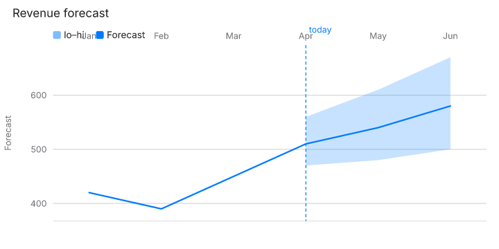
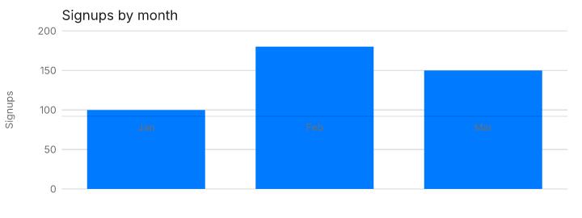
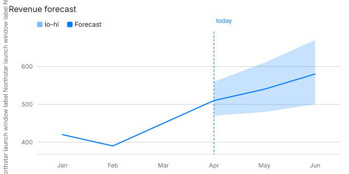
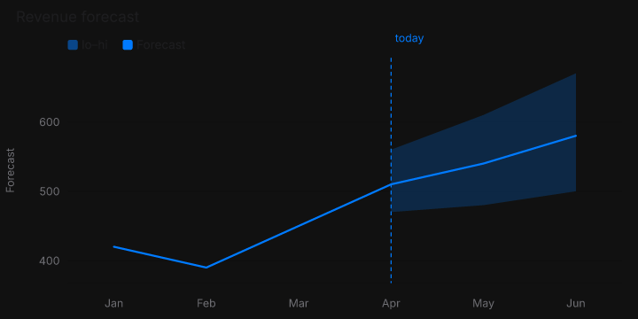

# Chart render sweep

Seed `20261105`. Mode `full`. 29372 cases, 22046 rendered, 87.7s.

ChartKit does not rewrite or shorten labels. An overlap is a layout bug. Spec-set sizes are left as the example wrote them, except when the sweep itself sets `size`.

## Snapshots

Wrote the dHash baseline for this mode. Baselines are 64-bit hashes at raster width 96, not PNGs. A full sweep is about twenty thousand renders. Committing every PNG would add tens of megabytes. The hash catches a changed picture and stays small. Flagged renders are written under scripts/render-harness/out/png, and a few display-sized frames are copied into report/examples.

Compared 22044. Changed 0. Missing baseline 0. Tolerance 8 bits on a 64-bit dHash.

## Timing

Render p50 0.2 ms, p95 2.3 ms, max 2079.8 ms.

## Findings by check

| Check | Count |
| --- | ---: |
| contrast | 4921 |
| text-outside | 3405 |
| text-overlap | 1980 |
| mark-outside | 480 |
| text-clipped | 32 |
| snapshot | 2 |
| render-time | 1 |

## Findings by chart type

| Type | Count |
| --- | ---: |
| bar | 1039 |
| line | 853 |
| candlestick | 814 |
| combo | 747 |
| scatter | 582 |
| spike | 433 |
| strip | 426 |
| area-range | 417 |
| waterfall | 414 |
| streamgraph | 409 |
| stacked-area | 379 |
| treemap | 352 |
| histogram | 326 |
| boxplot | 295 |
| heatmap | 256 |
| errorbar | 248 |
| bar-range | 232 |
| density | 232 |
| donut | 219 |
| gauge | 209 |
| pie | 208 |
| radar | 158 |
| quadrant | 153 |
| journey | 151 |
| choropleth | 149 |
| kpi | 133 |
| funnel | 130 |
| radial-bar | 120 |
| gantt | 116 |
| rose | 107 |
| timeline | 89 |
| sunburst | 87 |
| map-points | 62 |
| tree | 57 |
| bullet | 52 |
| sankey | 50 |
| venn | 48 |
| progress-ring | 45 |
| bar-list | 14 |
| mini-area | 5 |
| sparkline | 5 |

## Root-cause groups

A group is one check failing the same way. Counts are findings, not chart types.

### 1. contrast · label (3298)

Types: area-range, bar, bar-list, bar-range, boxplot, bullet, candlestick, combo, density, donut, errorbar, funnel, gantt, gauge, heatmap, histogram, journey, kpi, line, pie, progress-ring, quadrant, radar, radial-bar, rose, sankey, scatter, spike, streamgraph, strip, sunburst, timeline, tree, treemap, venn, waterfall

Options: axes.x.offset, axes.y.format.prefix, axes.y.format.suffix, axes.y.offset, axes.y2.format.prefix, axes.y2.format.suffix, encoding.color, encoding.color.value

- `area-range` / `30-area-range` / ``
  Label “today” is 4.02:1 on #ffffff in light mode. Minimum is 4.5:1.
- `area-range` / `30-area-range` / `theme` = "emerald"
  Label “400” is 4.18:1 on #0a0a0a in dark mode. Minimum is 4.5:1.
- `area-range` / `30-area-range` / `theme` = "emerald"
  Label “500” is 4.18:1 on #0a0a0a in dark mode. Minimum is 4.5:1.

### 2. text-outside · label (2291)

Types: area-range, bar, bar-range, boxplot, bullet, candlestick, choropleth, combo, density, donut, errorbar, funnel, gantt, gauge, heatmap, histogram, journey, kpi, line, map-points, mini-area, pie, progress-ring, quadrant, radar, radial-bar, rose, sankey, scatter, sparkline, spike, stacked-area, streamgraph, strip, sunburst, timeline, tree, treemap, venn, waterfall

Options: axes.x.format, axes.x.format.currency, axes.x.format.decimals, axes.x.format.prefix, axes.x.format.signed, axes.x.format.specifier, axes.x.format.suffix, axes.x.offset

- `area-range` / `30-area-range` / `axes.x.offset` = 1000000
  Label “Jan” extends outside the viewBox. ChartKit does not rewrite or shorten labels. Overlap is a layout bug. The spec size wins.
- `area-range` / `30-area-range` / `axes.x.offset` = 1000000
  Label “Feb” extends outside the viewBox. ChartKit does not rewrite or shorten labels. Overlap is a layout bug. The spec size wins.
- `area-range` / `30-area-range` / `axes.x.offset` = 1000000
  Label “Mar” extends outside the viewBox. ChartKit does not rewrite or shorten labels. Overlap is a layout bug. The spec size wins.

### 3. text-overlap · label × label (1196)

Types: area-range, bar, candlestick, choropleth, combo, donut, gantt, gauge, heatmap, journey, line, map-points, pie, quadrant, rose, sankey, scatter, spike, stacked-area, streamgraph, strip, sunburst, timeline, treemap, venn, waterfall

Options: axes.x.format, axes.x.format.decimals, axes.x.format.prefix, axes.x.format.suffix, axes.x.offset, axes.x.position, axes.x.rotate, axes.x.titleRotate

- `area-range` / `30-area-range` / `axes.x.position` = "left"
  Label “Apr” overlaps Label “today”. ChartKit does not rewrite or shorten labels. Overlap is a layout bug. The spec size wins.
- `area-range` / `30-area-range` / `axes.x.position` = "top"
  Label “Apr” overlaps Label “today”. ChartKit does not rewrite or shorten labels. Overlap is a layout bug. The spec size wins.
- `area-range` / `30-area-range` / `axes.y.position` = "right"
  Label “500” overlaps Label “Forecast”. ChartKit does not rewrite or shorten labels. Overlap is a layout bug. The spec size wins.

### 4. contrast · tick (999)

Types: bar, combo, gantt, gauge, heatmap, line, stacked-area, timeline

Options: axes.x.offset, axes.y.format.prefix, axes.y.format.suffix, axes.y.offset, axes.y2.format.prefix, axes.y2.format.suffix, axes.y2.offset, encoding.y.axis

- `bar` / `03-bar` / `axes.x.offset` = -80
  Tick label “Jan” is 1.26:1 on #007aff in light mode. Minimum is 4.5:1.
- `bar` / `03-bar` / `axes.x.offset` = -80
  Tick label “Feb” is 1.26:1 on #007aff in light mode. Minimum is 4.5:1.
- `bar` / `03-bar` / `axes.x.offset` = -80
  Tick label “Mar” is 1.26:1 on #007aff in light mode. Minimum is 4.5:1.

### 5. text-outside · tick (682)

Types: area-range, bar, bar-range, boxplot, candlestick, combo, density, errorbar, gauge, heatmap, histogram, line, scatter, spike, stacked-area, streamgraph, strip, tree, waterfall

Options: axes.x.crosses, axes.x.offset, axes.x.position, axes.x.title, axes.y.format, axes.y.format.currency, axes.y.format.decimals, axes.y.format.prefix

- `area-range` / `30-area-range` / `axes.y.title` = "Northstar launch window label Northstar launch window label Northstar launch window label Northstar launch window label"
  Tick label “Northstar launch window label Northstar launch window label Northstar launch window label Northstar launch window label” extends outside the viewBox. ChartKit does not rewrite or shorten labels. Overlap is a layout bug. The spec size wins.
- `area-range` / `30-area-range` / `encoding.y.title` = "Northstar launch window label Northstar launch window label Northstar launch window label Northstar launch window label"
  Tick label “Northstar launch window label Northstar launch window label Northstar launch window label Northstar launch window label” extends outside the viewBox. ChartKit does not rewrite or shorten labels. Overlap is a layout bug. The spec size wins.
- `area-range` / `revenue-forecast` / `axes.y.title` = "Northstar launch window label Northstar launch window label Northstar launch window label Northstar launch window label"
  Tick label “Northstar launch window label Northstar launch window label Northstar launch window label Northstar launch window label” extends outside the viewBox. ChartKit does not rewrite or shorten labels. Overlap is a layout bug. The spec size wins.

### 6. mark-outside (480)

Types: area-range, bar-range, boxplot, candlestick, density, donut, errorbar, gantt, gauge, heatmap, histogram, journey, pie, spike, streamgraph, strip, waterfall

Options: axes.y.format.prefix, axes.y.format.suffix, encoding.close.format.prefix, encoding.close.format.suffix, encoding.high.format.prefix, encoding.high.format.suffix, encoding.open.format.prefix, encoding.open.format.suffix

- `area-range` / `30-area-range` / `axes.y.format.prefix` = "Northstar launch window label Northstar launch window label Northstar launch window label Northstar launch window label"
  Mark band is outside the viewBox.
- `area-range` / `30-area-range` / `axes.y.format.prefix` = "Northstar launch window label Northstar launch window label Northstar launch window label Northstar launch window label"
  Mark line is outside the viewBox.
- `area-range` / `30-area-range` / `axes.y.format.suffix` = "Northstar launch window label Northstar launch window label Northstar launch window label Northstar launch window label"
  Mark band is outside the viewBox.

### 7. contrast · legend (336)

Types: area-range, bar, combo, density, donut, gantt, line, pie, radar, radial-bar, scatter, stacked-area, streamgraph, sunburst, treemap

Options: legend.anchor, legend.orient, legend.position, legend.position×title, mark.stack, theme, theme.tokens.background, theme.tokens.muted

- `area-range` / `30-area-range` / `theme.tokens.background` = "#111111"
  Legend item “lo–hi” is 1.12:1 on #111111 in light mode. Minimum is 4.5:1.
- `area-range` / `30-area-range` / `theme.tokens.background` = "#111111"
  Legend item “Forecast” is 1.12:1 on #111111 in light mode. Minimum is 4.5:1.
- `area-range` / `30-area-range` / `theme.tokens.background` = "#f5f5f7"
  Legend item “lo–hi” is 1.00:1 on #f5f5f7 in dark mode. Minimum is 4.5:1.

### 8. contrast · title (288)

Types: area-range, bar, bar-range, boxplot, density, donut, errorbar, funnel, gantt, gauge, histogram, journey, kpi, line, pie, progress-ring, quadrant, radar, radial-bar, rose, sankey, scatter, streamgraph, strip, sunburst, timeline, tree, treemap, venn, waterfall

Options: metric.delta, theme, theme.tokens.background, theme.tokens.fontSize, theme.tokens.positive, theme.tokens.surface, theme.tokens.text, title

- `area-range` / `30-area-range` / `theme.tokens.background` = "#111111"
  Title “Revenue forecast” is 1.12:1 on #111111 in light mode. Minimum is 4.5:1.
- `area-range` / `30-area-range` / `theme.tokens.background` = "#f5f5f7"
  Title “Revenue forecast” is 1.00:1 on #f5f5f7 in dark mode. Minimum is 4.5:1.
- `area-range` / `30-area-range` / `theme.tokens.text` = "#111111"
  Title “Revenue forecast” is 1.04:1 on #0c0c0c in dark mode. Minimum is 4.5:1.

### 9. text-overlap · legend × title (273)

Types: area-range, bar, density, donut, gantt, line, pie, radar, radial-bar, scatter, streamgraph, treemap

Options: legend.align, legend.anchor, legend.maxRows, legend.orient, legend.position, legend.position×title, legend.symbol, legend.title

- `area-range` / `30-area-range` / `theme.tokens.fontSize` = 32
  Title “Revenue forecast” overlaps Legend item “Forecast”. ChartKit does not rewrite or shorten labels. Overlap is a layout bug. The spec size wins.
- `area-range` / `30-area-range` / `theme.tokens.fontSize` = 32
  Title “Revenue forecast” overlaps Legend item “lo–hi”. ChartKit does not rewrite or shorten labels. Overlap is a layout bug. The spec size wins.
- `area-range` / `revenue-forecast` / `theme.tokens.fontSize` = 32
  Title “Revenue forecast” overlaps Legend item “revenue”. ChartKit does not rewrite or shorten labels. Overlap is a layout bug. The spec size wins.

### 10. text-outside · title (231)

Types: area-range, bar, bar-range, boxplot, bullet, candlestick, combo, density, donut, errorbar, funnel, gantt, gauge, heatmap, histogram, journey, kpi, line, mini-area, pie, progress-ring, quadrant, radar, radial-bar, rose, sankey, scatter, sparkline, spike, stacked-area, streamgraph, strip, sunburst, timeline, tree, treemap, venn, waterfall

Options: axes.y.format.prefix, axes.y.format.suffix, encoding.y.format.prefix, encoding.y.format.suffix, mark.labelFormat.prefix, mark.labelFormat.suffix, metric.deltaFormat, metric.deltaFormat.decimals

- `area-range` / `30-area-range` / `theme.tokens.fontSize` = 32
  Title “Revenue forecast” extends outside the viewBox. ChartKit does not rewrite or shorten labels. Overlap is a layout bug. The spec size wins.
- `area-range` / `30-area-range` / `title` = "Northstar launch window label Northstar launch window label Northstar launch window label Northstar launch window label"
  Title “Northstar launch window label Northstar launch window label Northstar launch window label Northstar launch window label” extends outside the viewBox. ChartKit does not rewrite or shorten labels. Overlap is a layout bug. The spec size wins.
- `area-range` / `revenue-forecast` / `theme.tokens.fontSize` = 32
  Title “Revenue forecast” extends outside the viewBox. ChartKit does not rewrite or shorten labels. Overlap is a layout bug. The spec size wins.

### 11. text-outside · legend (201)

Types: area-range, bar, choropleth, combo, density, donut, gantt, line, pie, radar, radial-bar, scatter, stacked-area, streamgraph, strip, treemap

Options: axes.y.format.prefix, axes.y.format.suffix, encoding.y, encoding.y.format.prefix, encoding.y.format.suffix, encoding.y.title, legend.anchor, legend.position

- `area-range` / `30-area-range` / `encoding.y.title` = "Northstar launch window label Northstar launch window label Northstar launch window label Northstar launch window label"
  Legend item “Northstar launch window label Northstar launch window label Northstar launch window label Northstar launch window label” extends outside the viewBox. ChartKit does not rewrite or shorten labels. Overlap is a layout bug. The spec size wins.
- `area-range` / `revenue-forecast` / `encoding.y` = "Northstar launch window label Northstar launch window label Northstar launch window label Northstar launch window label"
  Legend item “Northstar launch window label Northstar launch window label Northstar launch window label Northstar launch window label” extends outside the viewBox. ChartKit does not rewrite or shorten labels. Overlap is a layout bug. The spec size wins.
- `area-range` / `revenue-forecast` / `encoding.y.title` = "Northstar launch window label Northstar launch window label Northstar launch window label Northstar launch window label"
  Legend item “Northstar launch window label Northstar launch window label Northstar launch window label Northstar launch window label” extends outside the viewBox. ChartKit does not rewrite or shorten labels. Overlap is a layout bug. The spec size wins.

### 12. text-overlap · label × tick (186)

Types: bar, combo, gantt, line, stacked-area, strip

Options: axes.x.offset, axes.x.position, axes.x.rotate, axes.y.format.prefix, axes.y.format.suffix, axes.y.rotate, axes.y.title, axes.y.titleRotate

- `bar` / `03-bar` / `mark.labelFormat.prefix` = "Northstar launch window label Northstar launch window label Northstar launch window label Northstar launch window label"
  Label “Northstar launch window label Northstar launch window label Northstar launch window label Northstar launch window label100” overlaps Tick label “100”. ChartKit does not rewrite or shorten labels. Overlap is a layout bug. The spec size wins.
- `bar` / `03-bar` / `mark.labelFormat.prefix` = "Northstar launch window label Northstar launch window label Northstar launch window label Northstar launch window label"
  Label “Northstar launch window label Northstar launch window label Northstar launch window label Northstar launch window label180” overlaps Tick label “200”. ChartKit does not rewrite or shorten labels. Overlap is a layout bug. The spec size wins.
- `bar` / `03-bar` / `mark.labelFormat.suffix` = "Northstar launch window label Northstar launch window label Northstar launch window label Northstar launch window label"
  Label “100Northstar launch window label Northstar launch window label Northstar launch window label Northstar launch window label” overlaps Tick label “100”. ChartKit does not rewrite or shorten labels. Overlap is a layout bug. The spec size wins.

### 13. text-overlap · tick × tick (113)

Types: bar, combo, gauge, heatmap, line, stacked-area

Options: axes.y.format.prefix, axes.y.format.suffix, axes.y.position, axes.y2.format.prefix, axes.y2.format.suffix, axes.y2.position, encoding.y.format.prefix, encoding.y.format.suffix

- `bar` / `03-bar` / `axes.y.format.prefix` = "Northstar launch window label Northstar launch window label Northstar launch window label Northstar launch window label"
  Tick label “Jan” overlaps Tick label “Mar”. ChartKit does not rewrite or shorten labels. Overlap is a layout bug. The spec size wins.
- `bar` / `03-bar` / `axes.y.format.suffix` = "Northstar launch window label Northstar launch window label Northstar launch window label Northstar launch window label"
  Tick label “Jan” overlaps Tick label “Mar”. ChartKit does not rewrite or shorten labels. Overlap is a layout bug. The spec size wins.
- `bar` / `03-bar` / `encoding.y.format.prefix` = "Northstar launch window label Northstar launch window label Northstar launch window label Northstar launch window label"
  Tick label “Jan” overlaps Tick label “Mar”. ChartKit does not rewrite or shorten labels. Overlap is a layout bug. The spec size wins.

### 14. text-overlap · legend × legend (78)

Types: area-range, bar, choropleth, combo, donut, gantt, line, pie, radar, radial-bar, scatter, stacked-area, streamgraph, treemap

Options: legend.anchor, legend.maxRows, legend.position, legend.position×title, size.height, theme.tokens.fontSize

- `area-range` / `30-area-range` / `theme.tokens.fontSize` = 32
  Legend item “lo–hi” overlaps Legend item “Forecast”. ChartKit does not rewrite or shorten labels. Overlap is a layout bug. The spec size wins.
- `area-range` / `revenue-forecast` / `theme.tokens.fontSize` = 32
  Legend item “lo–hi” overlaps Legend item “revenue”. ChartKit does not rewrite or shorten labels. Overlap is a layout bug. The spec size wins.
- `bar` / `channels-bar` / `theme.tokens.fontSize` = 32
  Legend item “Direct” overlaps Legend item “Social”. ChartKit does not rewrite or shorten labels. Overlap is a layout bug. The spec size wins.

### 15. text-overlap · label × title (52)

Types: bar-range, bullet, donut, funnel, gantt, gauge, heatmap, histogram, journey, kpi, line, pie, progress-ring, quadrant, radial-bar, rose, strip, tree, treemap

Options: size.width×legend.position, theme.tokens.fontSize, title

- `bar-range` / `31-bar-range` / `theme.tokens.fontSize` = 32
  Title “Temperature” overlaps Label “30°C”. ChartKit does not rewrite or shorten labels. Overlap is a layout bug. The spec size wins.
- `bar-range` / `temperature-range` / `theme.tokens.fontSize` = 32
  Title “Temperature” overlaps Label “30°C”. ChartKit does not rewrite or shorten labels. Overlap is a layout bug. The spec size wins.
- `bullet` / `22-bullet` / `theme.tokens.fontSize` = 32
  Title “Revenue” overlaps Label “275”. ChartKit does not rewrite or shorten labels. Overlap is a layout bug. The spec size wins.

### 16. text-overlap · title × title (48)

Types: area-range, donut, gantt, journey, kpi, pie, quadrant, rose, sunburst, timeline, treemap, venn, waterfall

Options: metric.format.prefix, metric.format.suffix, theme.tokens.fontSize

- `area-range` / `30-area-range` / `theme.tokens.fontSize` = 32
  Title “Revenue forecast” overlaps Title “today”. ChartKit does not rewrite or shorten labels. Overlap is a layout bug. The spec size wins.
- `donut` / `04-donut` / `theme.tokens.fontSize` = 32
  Title “42%” overlaps Title “28%”. ChartKit does not rewrite or shorten labels. Overlap is a layout bug. The spec size wins.
- `donut` / `04-donut` / `theme.tokens.fontSize` = 32
  Title “28%” overlaps Title “18%”. ChartKit does not rewrite or shorten labels. Overlap is a layout bug. The spec size wins.

### 17. text-overlap · label × legend (30)

Types: area-range, choropleth, gantt, line, pie, radar, radial-bar, strip, treemap

Options: axes.x.position, encoding.y, encoding.y.title, legend.anchor, legend.position, legend.position×title, size.height, size.width

- `area-range` / `30-area-range` / `axes.x.position` = "left"
  Label “Jan” overlaps Legend item “lo–hi”. ChartKit does not rewrite or shorten labels. Overlap is a layout bug. The spec size wins.
- `area-range` / `30-area-range` / `axes.x.position` = "top"
  Label “Jan” overlaps Legend item “lo–hi”. ChartKit does not rewrite or shorten labels. Overlap is a layout bug. The spec size wins.
- `area-range` / `30-area-range` / `encoding.y.title` = "Northstar launch window label Northstar launch window label Northstar launch window label Northstar launch window label"
  Legend item “Northstar launch window label Northstar launch window label Northstar launch window label Northstar launch window label” overlaps Label “today”. ChartKit does not rewrite or shorten labels. Overlap is a layout bug. The spec size wins.

### 18. text-clipped · label (20)

Types: map-points, waterfall

Options: axes.y.format, axes.y.format.decimals, encoding.y.format, encoding.y.format.decimals, mark.labelFormat, mark.labelFormat.decimals, size.width, size.width×legend.position

- `map-points` / `city-points` / `size.width` = ""
  Label “Shanghai” is clipped by the plot. ChartKit does not rewrite or shorten labels. Overlap is a layout bug. The spec size wins.
- `map-points` / `city-points` / `size.width` = "240"
  Label “Cairo” is clipped by the plot. ChartKit does not rewrite or shorten labels. Overlap is a layout bug. The spec size wins.
- `map-points` / `city-points` / `size.width` = "240"
  Label “Lagos” is clipped by the plot. ChartKit does not rewrite or shorten labels. Overlap is a layout bug. The spec size wins.

### 19. text-clipped · tick (8)

Types: waterfall

Options: encoding.y.scale.padding.min, size.width×legend.position

- `waterfall` / `23-waterfall` / `size.width×legend.position` = {"size.width":"240","legend.position":"right","size.height":"160"}
  Tick label “22” is clipped by the plot. ChartKit does not rewrite or shorten labels. Overlap is a layout bug. The spec size wins.
- `waterfall` / `23-waterfall` / `size.width×legend.position` = {"size.width":"240","legend.position":"right","size.height":"160"}
  Tick label “-30” is clipped by the plot. ChartKit does not rewrite or shorten labels. Overlap is a layout bug. The spec size wins.
- `waterfall` / `23-waterfall` / `size.width×legend.position` = {"size.width":"240","legend.position":"top","size.height":"160"}
  Tick label “22” is clipped by the plot. ChartKit does not rewrite or shorten labels. Overlap is a layout bug. The spec size wins.

### 20. text-clipped · title (4)

Types: waterfall

Options: theme.tokens.fontSize

- `waterfall` / `23-waterfall` / `theme.tokens.fontSize` = 32
  Title “22” is clipped by the plot. ChartKit does not rewrite or shorten labels. Overlap is a layout bug. The spec size wins.
- `waterfall` / `23-waterfall` / `theme.tokens.fontSize` = 32
  Title “-30” is clipped by the plot. ChartKit does not rewrite or shorten labels. Overlap is a layout bug. The spec size wins.
- `waterfall` / `quarter-waterfall` / `theme.tokens.fontSize` = 32
  Title “40” is clipped by the plot. ChartKit does not rewrite or shorten labels. Overlap is a layout bug. The spec size wins.

### 21. text-overlap · tick × title (4)

Types: radar, tree

Options: mark.orient, size.width×legend.position

- `radar` / `18-radar` / `size.width×legend.position` = {"size.width":"240","legend.position":"right","size.height":"160"}
  Title “Model comparison” overlaps Tick label “Speed”. ChartKit does not rewrite or shorten labels. Overlap is a layout bug. The spec size wins.
- `radar` / `18-radar` / `size.width×legend.position` = {"size.width":"240","legend.position":"top","size.height":"160"}
  Title “Model comparison” overlaps Tick label “Speed”. ChartKit does not rewrite or shorten labels. Overlap is a layout bug. The spec size wins.
- `tree` / `45-tree` / `mark.orient` = "BT"
  Title “One hierarchy” overlaps Tick label “A1”. ChartKit does not rewrite or shorten labels. Overlap is a layout bug. The spec size wins.

### 22. snapshot (2)

Types: mini-area, sparkline

Options: size.width

- `mini-area` / `13-mini-area` / `size.width` = "10000"
  Raster failed: Target size is zero (please do not set the width/height/zoom options to 0)
- `sparkline` / `12-sparkline` / `size.width` = "10000"
  Raster failed: Target size is zero (please do not set the width/height/zoom options to 0)

### 23. render-time (1)

Types: candlestick

Options: encoding.x.scale.padding.max

- `candlestick` / `week-candles` / `encoding.x.scale.padding.max` = 1000000
  Render took 2080 ms.

## Recorded, not failed

Not yet supported: 599 options. Needs data: 2478. Unsampled (JSON, or the type field): 95.

An option the playground marks “Not yet supported” is listed and not rendered. A needs-data option is the same: the example cannot exercise it, so a failure there would be the fixture, not the chart.

## Vision

Vision review is a stub. Call reviewFlagged(findings, reviewer) with a reviewer that implements review({ findings, images }). This sweep does not call a model.

Flagged images: 38.
