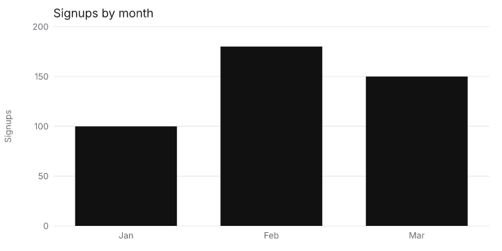
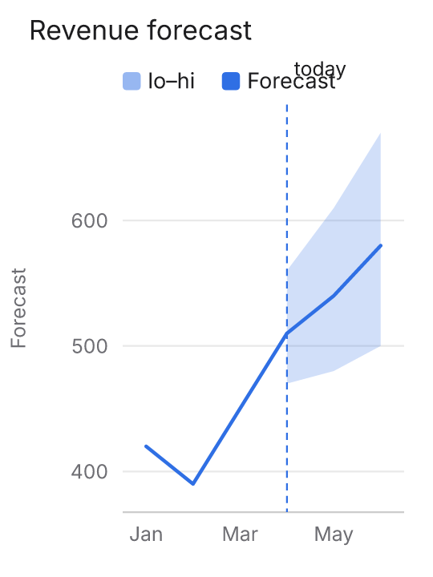
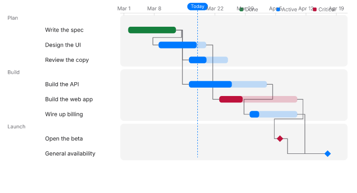

# Chart render sweep

Seed `20261105`. Mode `full`. 34731 cases, 27319 rendered, 38.9s.

ChartKit does not rewrite or shorten labels. An overlap is a layout bug. Spec-set sizes are left as the example wrote them, except when the sweep itself sets `size`.

## Snapshots

Baselines are committed dHash values, not PNGs, so the repo does not carry a render of every option.

Compared 27317. Changed 0. Missing baseline 0. Tolerance 8 bits on a 64-bit dHash.

## Timing

Render p50 0.1 ms, p95 1.1 ms, max 1063.7 ms.

## Findings by check

| Check | Count |
| --- | ---: |
| contrast | 561 |
| text-outside | 189 |
| text-overlap | 183 |
| mark-outside | 33 |
| text-clipped | 8 |
| legend-overlap | 2 |

## Findings by chart type

| Type | Count |
| --- | ---: |
| combo | 258 |
| line | 136 |
| strip | 134 |
| spike | 74 |
| journey | 60 |
| heatmap | 47 |
| bar | 36 |
| stacked-area | 36 |
| pie | 28 |
| gantt | 25 |
| donut | 24 |
| waterfall | 16 |
| timeline | 13 |
| treemap | 12 |
| candlestick | 11 |
| quadrant | 9 |
| bar-list | 8 |
| choropleth | 8 |
| kpi | 7 |
| sunburst | 7 |
| map-points | 6 |
| streamgraph | 6 |
| radar | 5 |
| area-range | 3 |
| scatter | 3 |
| density | 2 |
| sankey | 1 |
| venn | 1 |

## Root-cause groups

A group is one check failing the same way. Counts are findings, not chart types.

### 1. contrast · label (356)

Types: bar, bar-list, combo, gantt, line, pie, stacked-area, strip

Options: axes.x.offset, headline.tone, legend.anchor, legend.position, legend.position×title, mark.labelEnds, mark.labelFormat, mark.labelFormat.decimals

- `bar` / `signups-plan-region` / `mark.labelFormat` = "bytes"
  Label “430 B” is 3.07:1 on #e06a35 in dark mode. Minimum is 4.5:1.
- `bar` / `signups-plan-region` / `mark.labelFormat` = "currency"
  Label “$430.00” is 3.07:1 on #e06a35 in dark mode. Minimum is 4.5:1.
- `bar` / `signups-plan-region` / `mark.labelFormat` = "date"
  Label “Jan 1, 1970” is 3.07:1 on #e06a35 in dark mode. Minimum is 4.5:1.

### 2. contrast · mark (172)

Types: bar, candlestick, choropleth, combo, density, donut, gantt, heatmap, journey, line, map-points, pie, quadrant, stacked-area, streamgraph, strip, timeline, treemap, waterfall

Options: encoding.color, encoding.color.scale.bins, encoding.color.scale.type, encoding.color.value, encoding.y.color, theme, theme.tokens.accent, theme.tokens.negative

- `bar` / `03-bar` / `encoding.color.value` = "#111111"
  Mark #111111 is 1.04:1 on #0c0c0c in dark mode. Minimum for a graphic is 3:1.
- `bar` / `03-bar` / `encoding.color.value` = "#f5f5f7"
  Mark #f5f5f7 is 1.09:1 on #ffffff in light mode. Minimum for a graphic is 3:1.
- `bar` / `03-bar` / `encoding.y.color` = "#111111"
  Mark #111111 is 1.04:1 on #0c0c0c in dark mode. Minimum for a graphic is 3:1.

### 3. text-outside · label (160)

Types: combo, gantt, heatmap, journey, line, radar, scatter, spike, strip

Options: axes.x.offset, axes.y.offset, axes.y.position, axes.y.titleRotate, axes.y2.titleRotate, encoding.color.scale.type, encoding.x.type, layout.direction

- `combo` / `07-combo` / `axes.y2.titleRotate` = -360
  Label “Margin” extends outside the viewBox. ChartKit does not rewrite or shorten labels. Overlap is a layout bug. The spec size wins.
- `combo` / `07-combo` / `axes.y2.titleRotate` = 0
  Label “Margin” extends outside the viewBox. ChartKit does not rewrite or shorten labels. Overlap is a layout bug. The spec size wins.
- `combo` / `07-combo` / `axes.y2.titleRotate` = 360
  Label “Margin” extends outside the viewBox. ChartKit does not rewrite or shorten labels. Overlap is a layout bug. The spec size wins.

### 4. text-overlap · label × label (90)

Types: combo, line, pie, quadrant, sankey, spike, strip, timeline

Options: axes.x.offset, axes.y.position, axes.y2.position, encoding.x.type, layout.direction, size.width, size.width×legend.position

- `combo` / `07-combo` / `axes.y.position` = "right"
  Label “Revenue” overlaps Label “Margin”. ChartKit does not rewrite or shorten labels. Overlap is a layout bug. The spec size wins.
- `combo` / `07-combo` / `axes.y.position` = "top"
  Label “Revenue” overlaps Label “Margin”. ChartKit does not rewrite or shorten labels. Overlap is a layout bug. The spec size wins.
- `combo` / `07-combo` / `axes.y2.position` = "bottom"
  Label “Revenue” overlaps Label “Margin”. ChartKit does not rewrite or shorten labels. Overlap is a layout bug. The spec size wins.

### 5. text-overlap · tick × tick (40)

Types: candlestick, combo, heatmap, line

Options: axes.y.position, axes.y2.position, encoding.x.type, layout.direction, mark.layout, size.width×legend.position

- `candlestick` / `week-candles` / `encoding.x.type` = "quantitative"
  Tick label “2024-06-03T00:00:00Z” overlaps Tick label “2024-06-04T00:00:00Z”. ChartKit does not rewrite or shorten labels. Overlap is a layout bug. The spec size wins.
- `candlestick` / `week-candles` / `encoding.x.type` = "quantitative"
  Tick label “2024-06-04T00:00:00Z” overlaps Tick label “2024-06-05T00:00:00Z”. ChartKit does not rewrite or shorten labels. Overlap is a layout bug. The spec size wins.
- `candlestick` / `week-candles` / `encoding.x.type` = "quantitative"
  Tick label “2024-06-05T00:00:00Z” overlaps Tick label “2024-06-06T00:00:00Z”. ChartKit does not rewrite or shorten labels. Overlap is a layout bug. The spec size wins.

### 6. mark-outside (33)

Types: gantt, journey

Options: size.height, size.width, sort.by, sort.order

- `gantt` / `launch-gantt` / `size.height` = "240"
  Mark dependency is outside the viewBox.
- `gantt` / `launch-gantt` / `size.height` = "240"
  Mark dependency is outside the viewBox.
- `gantt` / `launch-gantt` / `size.height` = "240"
  Mark milestone is outside the viewBox.

### 7. text-overlap · label × tick (29)

Types: combo, line

Options: axes.x.offset, mark.labelEnds, mark.labelPosition, mark.labels

- `combo` / `07-combo` / `mark.labelPosition` = "bottom"
  Label “20%” overlaps Tick label “Jan”. ChartKit does not rewrite or shorten labels. Overlap is a layout bug. The spec size wins.
- `line` / `01-minimal-line` / `mark.labelPosition` = "bottom"
  Label “120” overlaps Tick label “Jan”. ChartKit does not rewrite or shorten labels. Overlap is a layout bug. The spec size wins.
- `line` / `quarterly-units` / `mark.labelPosition` = "bottom"
  Label “40” overlaps Tick label “Q1”. ChartKit does not rewrite or shorten labels. Overlap is a layout bug. The spec size wins.

### 8. text-outside · tick (23)

Types: bar, candlestick, heatmap, spike

Options: axes.x.position, encoding.x.type, mark.layout, mark.orientation

- `bar` / `signups-bar` / `mark.orientation` = "horizontal"
  Tick label “15.000” extends outside the viewBox. ChartKit does not rewrite or shorten labels. Overlap is a layout bug. The spec size wins.
- `candlestick` / `week-candles` / `encoding.x.type` = "quantitative"
  Tick label “2024-06-07T00:00:00Z” extends outside the viewBox. ChartKit does not rewrite or shorten labels. Overlap is a layout bug. The spec size wins.
- `heatmap` / `activity-calendar` / `mark.layout` = "grid"
  Tick label “2026-03-29” extends outside the viewBox. ChartKit does not rewrite or shorten labels. Overlap is a layout bug. The spec size wins.

### 9. contrast · tick (18)

Types: bar, gantt, line, sunburst, timeline

Options: legend.position×title, mark.labelPosition, title

- `bar` / `regions-bar` / `mark.labelPosition` = "center"
  Tick label “82” is 1.16:1 on #0c0c0c in dark mode. Minimum is 4.5:1.
- `bar` / `regions-bar` / `mark.labelPosition` = "inside"
  Tick label “82” is 1.16:1 on #0c0c0c in dark mode. Minimum is 4.5:1.
- `gantt` / `launch-gantt` / ``
  Tick label “Today” is 1.00:1 on #ffffff in light mode. Minimum is 4.5:1.

### 10. text-overlap · label × legend (14)

Types: area-range, pie, radar, strip, sunburst

Options: legend.anchor, legend.position, legend.position×title, size.width, size.width×legend.position

- `area-range` / `30-area-range` / `size.width` = "240"
  Legend item “Forecast” overlaps Label “today”. ChartKit does not rewrite or shorten labels. Overlap is a layout bug. The spec size wins.
- `area-range` / `30-area-range` / `size.width×legend.position` = {"size.width":"240","legend.position":"right","size.height":"160"}
  Legend item “Forecast” overlaps Label “today”. ChartKit does not rewrite or shorten labels. Overlap is a layout bug. The spec size wins.
- `area-range` / `30-area-range` / `size.width×legend.position` = {"size.width":"240","legend.position":"top","size.height":"160"}
  Legend item “Forecast” overlaps Label “today”. ChartKit does not rewrite or shorten labels. Overlap is a layout bug. The spec size wins.

### 11. contrast · title (10)

Types: kpi, treemap

Options: metric.delta, theme.tokens.fontSize, theme.tokens.positive

- `kpi` / `10-kpi` / `theme.tokens.positive` = "#111111"
  Title “↗ +12.5%” is 1.35:1 on #2c2c2e in dark mode. Minimum is 4.5:1.
- `kpi` / `10-kpi` / `theme.tokens.positive` = "#f5f5f7"
  Title “↗ +12.5%” is 1.09:1 on #ffffff in light mode. Minimum is 4.5:1.
- `kpi` / `error-kpi` / `metric.delta` = 0
  Title “↗ 0%” is 4.09:1 on #2c2c2e in dark mode. Minimum is 4.5:1.

### 12. text-clipped · tick (8)

Types: waterfall

Options: axes.x.offset, encoding.y.scale.padding.min, size.width×legend.position

- `waterfall` / `23-waterfall` / `size.width×legend.position` = {"size.width":"240","legend.position":"right","size.height":"160"}
  Tick label “22” is clipped by the plot. ChartKit does not rewrite or shorten labels. Overlap is a layout bug. The spec size wins.
- `waterfall` / `23-waterfall` / `size.width×legend.position` = {"size.width":"240","legend.position":"right","size.height":"160"}
  Tick label “-30” is clipped by the plot. ChartKit does not rewrite or shorten labels. Overlap is a layout bug. The spec size wins.
- `waterfall` / `23-waterfall` / `size.width×legend.position` = {"size.width":"240","legend.position":"top","size.height":"160"}
  Tick label “22” is clipped by the plot. ChartKit does not rewrite or shorten labels. Overlap is a layout bug. The spec size wins.

### 13. text-outside · title (6)

Types: bar, line, strip, venn

Options: size.width, size.width×legend.position

- `bar` / `signups-plan-region` / `size.width` = "240"
  Title “Signups by plan and region” extends outside the viewBox. ChartKit does not rewrite or shorten labels. Overlap is a layout bug. The spec size wins.
- `line` / `throughput-latency` / `size.width` = "240"
  Title “API throughput vs latency” extends outside the viewBox. ChartKit does not rewrite or shorten labels. Overlap is a layout bug. The spec size wins.
- `strip` / `36-strip` / `size.width` = "240"
  Title “Output tokens per working chart” extends outside the viewBox. ChartKit does not rewrite or shorten labels. Overlap is a layout bug. The spec size wins.

### 14. contrast · legend (5)

Types: combo, line

Options: mark.pointSize, mark.stack

- `combo` / `orders-combo` / `mark.stack` = "percent"
  Legend item “Orders” is 2.98:1 on #4a8ff0 in dark mode. Minimum is 4.5:1.
- `combo` / `orders-combo` / `mark.stack` = "percent"
  Legend item “Fill rate” is 2.98:1 on #4a8ff0 in dark mode. Minimum is 4.5:1.
- `combo` / `orders-combo` / `mark.stack` = "percent"
  Legend item “Orders” is 3.62:1 on #2f6fe4 in light mode. Minimum is 4.5:1.

### 15. text-overlap · legend × legend (5)

Types: pie

Options: legend.position, legend.position×title

- `pie` / `29-pie` / `legend.position` = "inside"
  Legend item “8%” overlaps Legend item “Direct”. ChartKit does not rewrite or shorten labels. Overlap is a layout bug. The spec size wins.
- `pie` / `29-pie` / `legend.position` = "inside"
  Legend item “8%” overlaps Legend item “Search”. ChartKit does not rewrite or shorten labels. Overlap is a layout bug. The spec size wins.
- `pie` / `29-pie` / `legend.position×title` = {"legend.position":"inside","title":""}
  Legend item “4%” overlaps Legend item “Search”. ChartKit does not rewrite or shorten labels. Overlap is a layout bug. The spec size wins.

### 16. legend-overlap · legend × tick (2)

Types: strip

Options: axes.x.position

- `strip` / `38-strip-vertical` / `axes.x.position` = "left"
  Legend overlaps the axis labels. ChartKit does not rewrite or shorten labels. Overlap is a layout bug. The spec size wins.
- `strip` / `38-strip-vertical` / `axes.x.position` = "top"
  Legend overlaps the axis labels. ChartKit does not rewrite or shorten labels. Overlap is a layout bug. The spec size wins.

### 17. text-overlap · legend × tick (2)

Types: strip

Options: axes.x.position

- `strip` / `38-strip-vertical` / `axes.x.position` = "left"
  Tick label “A” overlaps Legend item “Saturday”. ChartKit does not rewrite or shorten labels. Overlap is a layout bug. The spec size wins.
- `strip` / `38-strip-vertical` / `axes.x.position` = "top"
  Tick label “A” overlaps Legend item “Saturday”. ChartKit does not rewrite or shorten labels. Overlap is a layout bug. The spec size wins.

### 18. text-overlap · tick × title (2)

Types: radar

Options: size.width×legend.position

- `radar` / `18-radar` / `size.width×legend.position` = {"size.width":"240","legend.position":"right","size.height":"160"}
  Title “Model comparison” overlaps Tick label “Speed”. ChartKit does not rewrite or shorten labels. Overlap is a layout bug. The spec size wins.
- `radar` / `18-radar` / `size.width×legend.position` = {"size.width":"240","legend.position":"top","size.height":"160"}
  Title “Model comparison” overlaps Tick label “Speed”. ChartKit does not rewrite or shorten labels. Overlap is a layout bug. The spec size wins.

### 19. text-overlap · label × title (1)

Types: pie

Options: size.width×legend.position

- `pie` / `29-pie` / `size.width×legend.position` = {"size.width":"240","legend.position":"top","size.height":"160"}
  Title “Share of revenue” overlaps Label “28%”. ChartKit does not rewrite or shorten labels. Overlap is a layout bug. The spec size wins.

## Recorded, not failed

Not yet supported: 599 options. Needs data: 2478. Unsampled (JSON, or the type field): 136.

An option the playground marks “Not yet supported” is listed and not rendered. A needs-data option is the same: the example cannot exercise it, so a failure there would be the fixture, not the chart.

## Vision

Vision review is a stub. Call reviewFlagged(findings, reviewer) with a reviewer that implements review({ findings, images }). This sweep does not call a model.

Flagged images: 3.
