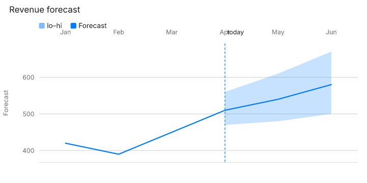

# Chart render sweep

Seed `20261105`. Mode `full`. 29372 cases, 22046 rendered, 84.5s.

ChartKit does not rewrite or shorten labels. An overlap is a layout bug. Spec-set sizes are left as the example wrote them, except when the sweep itself sets `size`.

## Snapshots

Wrote the dHash baseline for this mode. Baselines are 64-bit hashes at raster width 96, not PNGs. A full sweep is about twenty thousand renders. Committing every PNG would add tens of megabytes. The hash catches a changed picture and stays small. Flagged renders are written under scripts/render-harness/out/png, and a few display-sized frames are copied into report/examples.

Compared 22044. Changed 0. Missing baseline 0. Tolerance 8 bits on a 64-bit dHash.

## Timing

Render p50 0.2 ms, p95 2.3 ms, max 2020.3 ms.

## Findings by check

| Check | Count |
| --- | ---: |
| contrast | 1883 |
| text-overlap | 333 |
| text-outside | 190 |
| mark-outside | 35 |
| text-clipped | 14 |

## Findings by chart type

| Type | Count |
| --- | ---: |
| bar | 325 |
| combo | 299 |
| heatmap | 205 |
| rose | 140 |
| treemap | 121 |
| strip | 119 |
| gauge | 118 |
| funnel | 109 |
| line | 88 |
| spike | 82 |
| sunburst | 82 |
| timeline | 77 |
| radar | 68 |
| journey | 67 |
| donut | 63 |
| kpi | 52 |
| map-points | 51 |
| pie | 47 |
| candlestick | 36 |
| streamgraph | 36 |
| gantt | 32 |
| stacked-area | 28 |
| waterfall | 22 |
| sankey | 20 |
| choropleth | 19 |
| radial-bar | 19 |
| tree | 16 |
| bar-list | 15 |
| boxplot | 15 |
| scatter | 15 |
| area-range | 14 |
| quadrant | 12 |
| mini-area | 8 |
| sparkline | 8 |
| venn | 8 |
| density | 7 |
| bullet | 4 |
| bar-range | 2 |
| errorbar | 2 |
| histogram | 2 |
| progress-ring | 2 |

## Root-cause groups

A group is one check failing the same way. Counts are findings, not chart types.

### 1. contrast · mark (950)

Types: area-range, bar, bar-range, boxplot, bullet, candlestick, choropleth, combo, density, donut, errorbar, funnel, gantt, gauge, heatmap, histogram, journey, kpi, line, map-points, mini-area, pie, progress-ring, quadrant, radar, sankey, scatter, sparkline, spike, stacked-area, streamgraph, strip, sunburst, timeline, tree, treemap, waterfall

Options: encoding.color, encoding.color.scale.bins, encoding.color.scale.reverse, encoding.color.scale.scheme, encoding.color.scale.type, encoding.color.value, encoding.size, encoding.y.color

- `area-range` / `30-area-range` / `theme` = "latte"
  Line #40a02b is 2.96:1 on #eff1f5 in light mode. Minimum for a graphic is 3:1.
- `area-range` / `revenue-forecast` / `theme` = "latte"
  Line #40a02b is 2.96:1 on #eff1f5 in light mode. Minimum for a graphic is 3:1.
- `bar` / `03-bar` / `encoding.color.value` = "#111111"
  Mark #111111 is 1.04:1 on #0c0c0c in dark mode. Minimum for a graphic is 3:1.

### 2. contrast · label (886)

Types: bar, bar-list, combo, donut, gantt, kpi, pie, radial-bar, rose, sunburst, timeline, treemap

Options: encoding.y.format, encoding.y.format.decimals, encoding.y.format.signed, headline.tone, legend.anchor, legend.position, legend.position×title, mark.innerRadius

- `bar` / `03-bar` / `mark.labelPosition` = "bottom"
  Label “100” is 3.35:1 on #0a84ff in dark mode. Minimum is 4.5:1.
- `bar` / `03-bar` / `mark.labelPosition` = "bottom"
  Label “180” is 3.35:1 on #0a84ff in dark mode. Minimum is 4.5:1.
- `bar` / `03-bar` / `mark.labelPosition` = "bottom"
  Label “150” is 3.35:1 on #0a84ff in dark mode. Minimum is 4.5:1.

### 3. text-overlap · label × label (180)

Types: choropleth, combo, gauge, line, map-points, pie, quadrant, rose, sankey, spike, streamgraph, strip, sunburst, timeline, venn

Options: axes.x.offset, axes.y.position, axes.y2.position, encoding.color, encoding.size, encoding.x.type, layout.direction, legend.position

- `choropleth` / `us-population` / ``
  Label “Change” overlaps Label “8%”. ChartKit does not rewrite or shorten labels. Overlap is a layout bug. The spec size wins.
- `choropleth` / `us-population` / `size.width×legend.position` = {"size.width":"240","legend.position":"right","size.height":"160"}
  Label “-4%” overlaps Label “-2%”. ChartKit does not rewrite or shorten labels. Overlap is a layout bug. The spec size wins.
- `choropleth` / `us-population` / `size.width×legend.position` = {"size.width":"240","legend.position":"right","size.height":"160"}
  Label “4%” overlaps Label “6%”. ChartKit does not rewrite or shorten labels. Overlap is a layout bug. The spec size wins.

### 4. text-outside · label (160)

Types: choropleth, combo, gantt, heatmap, journey, line, map-points, radar, scatter, spike, streamgraph, strip, sunburst, tree, venn

Options: axes.x.offset, axes.y, axes.y.offset, axes.y.position, axes.y.titleRotate, axes.y2.titleRotate, encoding.color.scale.type, encoding.x.scale.reverse

- `choropleth` / `us-population` / `size.width` = "240"
  Label “Population change, 2020–2023” extends outside the viewBox. ChartKit does not rewrite or shorten labels. Overlap is a layout bug. The spec size wins.
- `choropleth` / `us-population` / `size.width×legend.position` = {"size.width":"240","legend.position":"right","size.height":"160"}
  Label “Population change, 2020–2023” extends outside the viewBox. ChartKit does not rewrite or shorten labels. Overlap is a layout bug. The spec size wins.
- `choropleth` / `us-population` / `size.width×legend.position` = {"size.width":"240","legend.position":"top","size.height":"160"}
  Label “Population change, 2020–2023” extends outside the viewBox. ChartKit does not rewrite or shorten labels. Overlap is a layout bug. The spec size wins.

### 5. text-overlap · tick × tick (75)

Types: area-range, candlestick, combo, gauge, heatmap, line

Options: axes.y.position, axes.y2.position, encoding.x.type, layout.direction, mark.layout, mark.startAngle, size.width, size.width×legend.position

- `area-range` / `revenue-forecast` / `size.width` = "240"
  Tick label “04:00 AM” overlaps Tick label “08:00 AM”. ChartKit does not rewrite or shorten labels. Overlap is a layout bug. The spec size wins.
- `area-range` / `revenue-forecast` / `size.width` = "240"
  Tick label “12:00 AM” overlaps Tick label “04:00 AM”. ChartKit does not rewrite or shorten labels. Overlap is a layout bug. The spec size wins.
- `area-range` / `revenue-forecast` / `size.width` = "240"
  Tick label “12:00 PM” overlaps Tick label “04:00 PM”. ChartKit does not rewrite or shorten labels. Overlap is a layout bug. The spec size wins.

### 6. mark-outside (35)

Types: donut, gantt, journey, strip

Options: mark.offset, mark.pointSize, size.height, size.width, sort.by, sort.order

- `donut` / `budget-pie` / `mark.offset` = 48
  Mark s:Travel is outside the viewBox.
- `gantt` / `launch-gantt` / `size.height` = "240"
  Mark dependency is outside the viewBox.
- `gantt` / `launch-gantt` / `size.height` = "240"
  Mark dependency is outside the viewBox.

### 7. text-overlap · label × tick (33)

Types: area-range, combo, line, strip

Options: axes.x.offset, axes.x.position, mark.labelEnds, mark.labelPosition, mark.labels

- `area-range` / `30-area-range` / `axes.x.position` = "left"
  Tick label “Apr” overlaps Label “today”. ChartKit does not rewrite or shorten labels. Overlap is a layout bug. The spec size wins.
- `area-range` / `30-area-range` / `axes.x.position` = "top"
  Tick label “Apr” overlaps Label “today”. ChartKit does not rewrite or shorten labels. Overlap is a layout bug. The spec size wins.
- `combo` / `07-combo` / `mark.labelPosition` = "bottom"
  Label “20%” overlaps Tick label “Jan”. ChartKit does not rewrite or shorten labels. Overlap is a layout bug. The spec size wins.

### 8. contrast · title (28)

Types: gauge, kpi, rose, treemap

Options: metric.delta, theme, theme.tokens.fontSize, theme.tokens.positive

- `gauge` / `09-gauge` / `theme` = "latte"
  Title “72” is 2.96:1 on #eff1f5 in light mode. Minimum is 3:1.
- `gauge` / `09-gauge` / `theme` = "sunset"
  Title “72” is 2.54:1 on #ffffff in light mode. Minimum is 3:1.
- `gauge` / `capacity-gauge` / `theme` = "latte"
  Title “72” is 2.96:1 on #eff1f5 in light mode. Minimum is 3:1.

### 9. text-outside · tick (24)

Types: bar, candlestick, heatmap, spike, tree

Options: axes.x.position, encoding.x.type, mark.layout, mark.orient, mark.orientation

- `bar` / `signups-bar` / `mark.orientation` = "horizontal"
  Tick label “15.000” extends outside the viewBox. ChartKit does not rewrite or shorten labels. Overlap is a layout bug. The spec size wins.
- `candlestick` / `week-candles` / `encoding.x.type` = "quantitative"
  Tick label “2024-06-07T00:00:00Z” extends outside the viewBox. ChartKit does not rewrite or shorten labels. Overlap is a layout bug. The spec size wins.
- `heatmap` / `activity-calendar` / `mark.layout` = "grid"
  Tick label “2026-03-29” extends outside the viewBox. ChartKit does not rewrite or shorten labels. Overlap is a layout bug. The spec size wins.

### 10. text-overlap · legend × legend (19)

Types: pie, treemap

Options: legend.anchor, legend.position, legend.position×title

- `pie` / `29-pie` / `legend.position` = "inside"
  Legend item “8%” overlaps Legend item “Direct”. ChartKit does not rewrite or shorten labels. Overlap is a layout bug. The spec size wins.
- `pie` / `29-pie` / `legend.position` = "inside"
  Legend item “8%” overlaps Legend item “Search”. ChartKit does not rewrite or shorten labels. Overlap is a layout bug. The spec size wins.
- `pie` / `29-pie` / `legend.position×title` = {"legend.position":"inside","title":""}
  Legend item “4%” overlaps Legend item “Search”. ChartKit does not rewrite or shorten labels. Overlap is a layout bug. The spec size wins.

### 11. contrast · legend (18)

Types: combo, treemap

Options: legend.anchor, legend.position, legend.position×title, mark.stack

- `combo` / `orders-combo` / `mark.stack` = "percent"
  Legend item “Orders” is 3.35:1 on #0a84ff in dark mode. Minimum is 4.5:1.
- `combo` / `orders-combo` / `mark.stack` = "percent"
  Legend item “Fill rate” is 3.35:1 on #0a84ff in dark mode. Minimum is 4.5:1.
- `combo` / `orders-combo` / `mark.stack` = "percent"
  Legend item “Orders” is 4.19:1 on #007aff in light mode. Minimum is 4.5:1.

### 12. text-overlap · label × legend (15)

Types: area-range, pie, radar, radial-bar, strip, treemap

Options: legend.anchor, legend.position, legend.position×title, size.width, size.width×legend.position

- `area-range` / `30-area-range` / `size.width` = "240"
  Legend item “Forecast” overlaps Label “today”. ChartKit does not rewrite or shorten labels. Overlap is a layout bug. The spec size wins.
- `area-range` / `30-area-range` / `size.width×legend.position` = {"size.width":"240","legend.position":"right","size.height":"160"}
  Legend item “Forecast” overlaps Label “today”. ChartKit does not rewrite or shorten labels. Overlap is a layout bug. The spec size wins.
- `area-range` / `30-area-range` / `size.width×legend.position` = {"size.width":"240","legend.position":"top","size.height":"160"}
  Legend item “Forecast” overlaps Label “today”. ChartKit does not rewrite or shorten labels. Overlap is a layout bug. The spec size wins.

### 13. text-clipped · tick (8)

Types: waterfall

Options: axes.x.offset, encoding.y.scale.padding.min, size.width×legend.position

- `waterfall` / `23-waterfall` / `size.width×legend.position` = {"size.width":"240","legend.position":"right","size.height":"160"}
  Tick label “22” is clipped by the plot. ChartKit does not rewrite or shorten labels. Overlap is a layout bug. The spec size wins.
- `waterfall` / `23-waterfall` / `size.width×legend.position` = {"size.width":"240","legend.position":"right","size.height":"160"}
  Tick label “-30” is clipped by the plot. ChartKit does not rewrite or shorten labels. Overlap is a layout bug. The spec size wins.
- `waterfall` / `23-waterfall` / `size.width×legend.position` = {"size.width":"240","legend.position":"top","size.height":"160"}
  Tick label “22” is clipped by the plot. ChartKit does not rewrite or shorten labels. Overlap is a layout bug. The spec size wins.

### 14. text-clipped · label (6)

Types: map-points

Options: size.width, size.width×legend.position

- `map-points` / `city-points` / `size.width` = ""
  Label “Shanghai” is clipped by the plot. ChartKit does not rewrite or shorten labels. Overlap is a layout bug. The spec size wins.
- `map-points` / `city-points` / `size.width` = "240"
  Label “Cairo” is clipped by the plot. ChartKit does not rewrite or shorten labels. Overlap is a layout bug. The spec size wins.
- `map-points` / `city-points` / `size.width` = "240"
  Label “Lagos” is clipped by the plot. ChartKit does not rewrite or shorten labels. Overlap is a layout bug. The spec size wins.

### 15. text-outside · title (6)

Types: bar, line, strip, venn

Options: size.width, size.width×legend.position

- `bar` / `signups-plan-region` / `size.width` = "240"
  Title “Signups by plan and region” extends outside the viewBox. ChartKit does not rewrite or shorten labels. Overlap is a layout bug. The spec size wins.
- `line` / `throughput-latency` / `size.width` = "240"
  Title “API throughput vs latency” extends outside the viewBox. ChartKit does not rewrite or shorten labels. Overlap is a layout bug. The spec size wins.
- `strip` / `36-strip` / `size.width` = "240"
  Title “Output tokens per working chart” extends outside the viewBox. ChartKit does not rewrite or shorten labels. Overlap is a layout bug. The spec size wins.

### 16. text-overlap · label × title (4)

Types: pie, radial-bar

Options: size.width×legend.position

- `pie` / `29-pie` / `size.width×legend.position` = {"size.width":"240","legend.position":"top","size.height":"160"}
  Title “Share of revenue” overlaps Label “28%”. ChartKit does not rewrite or shorten labels. Overlap is a layout bug. The spec size wins.
- `radial-bar` / `lumen-radial-bar` / `size.width×legend.position` = {"size.width":"240","legend.position":"right","size.height":"160"}
  Title “Lumen, minutes by desk” overlaps Label “Ident”. ChartKit does not rewrite or shorten labels. Overlap is a layout bug. The spec size wins.
- `radial-bar` / `lumen-radial-bar` / `size.width×legend.position` = {"size.width":"240","legend.position":"top","size.height":"160"}
  Title “Lumen, minutes by desk” overlaps Label “Ident”. ChartKit does not rewrite or shorten labels. Overlap is a layout bug. The spec size wins.

### 17. text-overlap · tick × title (4)

Types: radar, tree

Options: mark.orient, size.width×legend.position

- `radar` / `18-radar` / `size.width×legend.position` = {"size.width":"240","legend.position":"right","size.height":"160"}
  Title “Model comparison” overlaps Tick label “Speed”. ChartKit does not rewrite or shorten labels. Overlap is a layout bug. The spec size wins.
- `radar` / `18-radar` / `size.width×legend.position` = {"size.width":"240","legend.position":"top","size.height":"160"}
  Title “Model comparison” overlaps Tick label “Speed”. ChartKit does not rewrite or shorten labels. Overlap is a layout bug. The spec size wins.
- `tree` / `45-tree` / `mark.orient` = "BT"
  Title “One hierarchy” overlaps Tick label “A1”. ChartKit does not rewrite or shorten labels. Overlap is a layout bug. The spec size wins.

### 18. text-overlap · legend × title (3)

Types: donut, radial-bar

Options: legend.anchor, size.width×legend.position

- `donut` / `04-donut` / `legend.anchor` = "center"
  Title “100” overlaps Legend item “Social”. ChartKit does not rewrite or shorten labels. Overlap is a layout bug. The spec size wins.
- `donut` / `04-donut` / `legend.anchor` = "center"
  Title “100” overlaps Legend item “Direct”. ChartKit does not rewrite or shorten labels. Overlap is a layout bug. The spec size wins.
- `radial-bar` / `lumen-radial-bar` / `size.width×legend.position` = {"size.width":"240","legend.position":"right","size.height":"160"}
  Title “Lumen, minutes by desk” overlaps Legend item “Music”. ChartKit does not rewrite or shorten labels. Overlap is a layout bug. The spec size wins.

### 19. contrast · tick (1)

Types: gantt

- `gantt` / `launch-gantt` / ``
  Tick label “Today” is 1.00:1 on #ffffff in light mode. Minimum is 4.5:1.

## Recorded, not failed

Not yet supported: 599 options. Needs data: 2478. Unsampled (JSON, or the type field): 95.

An option the playground marks “Not yet supported” is listed and not rendered. A needs-data option is the same: the example cannot exercise it, so a failure there would be the fixture, not the chart.

## Vision

Vision review is a stub. Call reviewFlagged(findings, reviewer) with a reviewer that implements review({ findings, images }). This sweep does not call a model.

Flagged images: 10.
