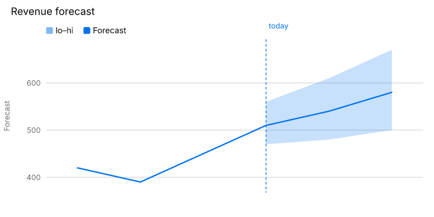
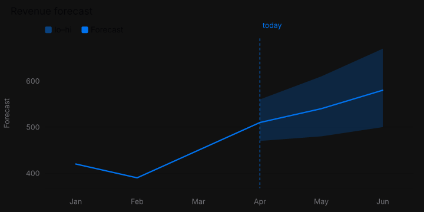

# Chart render sweep

Seed `20261105`. Mode `full`. 29372 cases, 22046 rendered, 76.2s.

ChartKit does not rewrite or shorten labels. An overlap is a layout bug. Spec-set sizes are left as the example wrote them, except when the sweep itself sets `size`.

## Snapshots

Wrote the dHash baseline for this mode. Baselines are 64-bit hashes at raster width 96, not PNGs. A full sweep is about twenty thousand renders. Committing every PNG would add tens of megabytes. The hash catches a changed picture and stays small. Flagged renders are written under scripts/render-harness/out/png, and a few display-sized frames are copied into report/examples.

Compared 22044. Changed 0. Missing baseline 0. Tolerance 8 bits on a 64-bit dHash.

## Timing

Render p50 0.2 ms, p95 2.1 ms, max 1939.1 ms.

## Findings by check

| Check | Count |
| --- | ---: |
| contrast | 4183 |
| text-outside | 1178 |
| text-overlap | 1059 |
| mark-outside | 480 |
| text-clipped | 32 |
| snapshot | 2 |
| render-time | 1 |

## Findings by chart type

| Type | Count |
| --- | ---: |
| line | 519 |
| bar | 488 |
| candlestick | 391 |
| strip | 364 |
| streamgraph | 287 |
| combo | 284 |
| waterfall | 268 |
| area-range | 265 |
| spike | 253 |
| stacked-area | 227 |
| histogram | 218 |
| heatmap | 208 |
| boxplot | 204 |
| scatter | 203 |
| density | 200 |
| pie | 184 |
| bar-range | 178 |
| errorbar | 177 |
| treemap | 175 |
| donut | 165 |
| gauge | 149 |
| radar | 142 |
| timeline | 141 |
| journey | 132 |
| sunburst | 125 |
| gantt | 121 |
| choropleth | 119 |
| radial-bar | 112 |
| funnel | 98 |
| kpi | 93 |
| quadrant | 79 |
| rose | 79 |
| tree | 53 |
| sankey | 46 |
| venn | 46 |
| map-points | 44 |
| bullet | 42 |
| progress-ring | 36 |
| bar-list | 18 |
| mini-area | 1 |
| sparkline | 1 |

## Root-cause groups

A group is one check failing the same way. Counts are findings, not chart types.

### 1. contrast · label (2571)

Types: area-range, bar-list, bar-range, boxplot, bullet, candlestick, combo, density, donut, errorbar, funnel, gantt, gauge, heatmap, histogram, journey, kpi, line, pie, progress-ring, quadrant, radar, radial-bar, rose, sankey, scatter, spike, streamgraph, strip, sunburst, timeline, tree, venn, waterfall

Options: axes.x.offset, axes.y.format.prefix, axes.y.format.suffix, axes.y.offset, axes.y2.format.prefix, axes.y2.format.suffix, mark.summary, subtitle

- `area-range` / `30-area-range` / ``
  Label “today” is 3.92:1 on #0c0c0c in dark mode. Minimum is 4.5:1.
- `area-range` / `30-area-range` / `theme` = "emerald"
  Label “400” is 4.18:1 on #0a0a0a in dark mode. Minimum is 4.5:1.
- `area-range` / `30-area-range` / `theme` = "emerald"
  Label “500” is 4.18:1 on #0a0a0a in dark mode. Minimum is 4.5:1.

### 2. contrast · tick (1015)

Types: bar, combo, gantt, gauge, heatmap, line, stacked-area

Options: axes.x.offset, axes.y.format.prefix, axes.y.format.suffix, axes.y.offset, axes.y2.format.prefix, axes.y2.format.suffix, axes.y2.offset, encoding.y.axis

- `bar` / `03-bar` / `axes.x.offset` = -80
  Tick label “Jan” is 1.12:1 on #0072ee in light mode. Minimum is 4.5:1.
- `bar` / `03-bar` / `axes.x.offset` = -80
  Tick label “Feb” is 1.12:1 on #0072ee in light mode. Minimum is 4.5:1.
- `bar` / `03-bar` / `axes.x.offset` = -80
  Tick label “Mar” is 1.12:1 on #0072ee in light mode. Minimum is 4.5:1.

### 3. text-outside · label (725)

Types: area-range, bar, bar-range, boxplot, candlestick, choropleth, combo, density, donut, errorbar, gantt, gauge, heatmap, histogram, journey, line, map-points, pie, quadrant, radar, radial-bar, rose, scatter, spike, stacked-area, streamgraph, strip, sunburst, tree, venn, waterfall

Options: axes.x.format, axes.x.format.decimals, axes.x.format.signed, axes.x.offset, axes.y, axes.y.format, axes.y.format.decimals, axes.y.offset

- `area-range` / `30-area-range` / `axes.x.offset` = 80
  Label “Jan” extends outside the viewBox. ChartKit does not rewrite or shorten labels. Overlap is a layout bug. The spec size wins.
- `area-range` / `30-area-range` / `axes.x.offset` = 80
  Label “Feb” extends outside the viewBox. ChartKit does not rewrite or shorten labels. Overlap is a layout bug. The spec size wins.
- `area-range` / `30-area-range` / `axes.x.offset` = 80
  Label “Mar” extends outside the viewBox. ChartKit does not rewrite or shorten labels. Overlap is a layout bug. The spec size wins.

### 4. text-overlap · label × label (494)

Types: area-range, candlestick, choropleth, combo, gantt, gauge, heatmap, journey, line, map-points, pie, quadrant, rose, sankey, scatter, spike, streamgraph, strip, sunburst, timeline, treemap, venn, waterfall

Options: axes.x.format, axes.x.offset, axes.x.position, axes.y.format, axes.y.position, axes.y2.position, encoding.color, encoding.color.format

- `area-range` / `30-area-range` / `axes.x.position` = "left"
  Label “Apr” overlaps Label “today”. ChartKit does not rewrite or shorten labels. Overlap is a layout bug. The spec size wins.
- `area-range` / `30-area-range` / `axes.x.position` = "top"
  Label “Apr” overlaps Label “today”. ChartKit does not rewrite or shorten labels. Overlap is a layout bug. The spec size wins.
- `area-range` / `30-area-range` / `axes.y.position` = "right"
  Label “500” overlaps Label “Forecast”. ChartKit does not rewrite or shorten labels. Overlap is a layout bug. The spec size wins.

### 5. mark-outside (480)

Types: area-range, bar-range, boxplot, candlestick, density, donut, errorbar, gantt, gauge, heatmap, histogram, journey, pie, spike, streamgraph, strip, waterfall

Options: axes.y.format.prefix, axes.y.format.suffix, encoding.close.format.prefix, encoding.close.format.suffix, encoding.high.format.prefix, encoding.high.format.suffix, encoding.open.format.prefix, encoding.open.format.suffix

- `area-range` / `30-area-range` / `axes.y.format.prefix` = "Northstar launch window label Northstar launch window label Northstar launch window label Northstar launch window label"
  Mark band is outside the viewBox.
- `area-range` / `30-area-range` / `axes.y.format.prefix` = "Northstar launch window label Northstar launch window label Northstar launch window label Northstar launch window label"
  Mark line is outside the viewBox.
- `area-range` / `30-area-range` / `axes.y.format.suffix` = "Northstar launch window label Northstar launch window label Northstar launch window label Northstar launch window label"
  Mark band is outside the viewBox.

### 6. contrast · legend (319)

Types: area-range, bar, combo, density, donut, gantt, line, pie, radar, radial-bar, scatter, stacked-area, streamgraph, sunburst, treemap

Options: legend.anchor, legend.orient, legend.position, legend.position×title, theme, theme.tokens.background, theme.tokens.muted, theme.tokens.text

- `area-range` / `30-area-range` / `theme.tokens.background` = "#111111"
  Legend item “lo–hi” is 1.08:1 on #111111 in light mode. Minimum is 4.5:1.
- `area-range` / `30-area-range` / `theme.tokens.background` = "#111111"
  Legend item “Forecast” is 1.08:1 on #111111 in light mode. Minimum is 4.5:1.
- `area-range` / `30-area-range` / `theme.tokens.background` = "#f5f5f7"
  Legend item “lo–hi” is 1.00:1 on #f5f5f7 in dark mode. Minimum is 4.5:1.

### 7. contrast · title (278)

Types: area-range, bar, bar-range, boxplot, density, donut, errorbar, funnel, gantt, gauge, histogram, journey, kpi, line, pie, progress-ring, quadrant, radar, radial-bar, rose, sankey, scatter, streamgraph, strip, sunburst, timeline, tree, treemap, venn, waterfall

Options: metric.delta, theme, theme.tokens.background, theme.tokens.fontSize, theme.tokens.positive, theme.tokens.surface, theme.tokens.text, title

- `area-range` / `30-area-range` / `theme.tokens.background` = "#111111"
  Title “Revenue forecast” is 1.08:1 on #111111 in light mode. Minimum is 4.5:1.
- `area-range` / `30-area-range` / `theme.tokens.background` = "#f5f5f7"
  Title “Revenue forecast” is 1.00:1 on #f5f5f7 in dark mode. Minimum is 4.5:1.
- `area-range` / `30-area-range` / `theme.tokens.text` = "#111111"
  Title “Revenue forecast” is 1.04:1 on #0c0c0c in dark mode. Minimum is 4.5:1.

### 8. text-outside · tick (239)

Types: bar, candlestick, combo, heatmap, line, spike, stacked-area, tree

Options: axes.x.offset, axes.x.position, axes.y.format, axes.y.format.decimals, axes.y.format.signed, axes.y.offset, axes.y2.offset, encoding.y.format

- `bar` / `03-bar` / `axes.x.offset` = 80
  Tick label “Jan” extends outside the viewBox. ChartKit does not rewrite or shorten labels. Overlap is a layout bug. The spec size wins.
- `bar` / `03-bar` / `axes.x.offset` = 80
  Tick label “Feb” extends outside the viewBox. ChartKit does not rewrite or shorten labels. Overlap is a layout bug. The spec size wins.
- `bar` / `03-bar` / `axes.x.offset` = 80
  Tick label “Mar” extends outside the viewBox. ChartKit does not rewrite or shorten labels. Overlap is a layout bug. The spec size wins.

### 9. text-overlap · legend × title (236)

Types: area-range, bar, density, donut, line, pie, radar, radial-bar, scatter, streamgraph, treemap

Options: legend.align, legend.anchor, legend.maxRows, legend.orient, legend.position, legend.position×title, legend.symbol, theme.tokens.fontSize

- `area-range` / `30-area-range` / `theme.tokens.fontSize` = 32
  Title “Revenue forecast” overlaps Legend item “Forecast”. ChartKit does not rewrite or shorten labels. Overlap is a layout bug. The spec size wins.
- `area-range` / `30-area-range` / `theme.tokens.fontSize` = 32
  Title “Revenue forecast” overlaps Legend item “lo–hi”. ChartKit does not rewrite or shorten labels. Overlap is a layout bug. The spec size wins.
- `area-range` / `revenue-forecast` / `theme.tokens.fontSize` = 32
  Title “Revenue forecast” overlaps Legend item “revenue”. ChartKit does not rewrite or shorten labels. Overlap is a layout bug. The spec size wins.

### 10. text-outside · legend (121)

Types: donut, gantt, pie, radar, radial-bar, streamgraph, strip, treemap

Options: legend.anchor, legend.position, legend.position×title, size.width×legend.position, theme.tokens.fontSize

- `donut` / `04-donut` / `legend.anchor` = "right"
  Legend item “Search” extends outside the viewBox. ChartKit does not rewrite or shorten labels. Overlap is a layout bug. The spec size wins.
- `donut` / `04-donut` / `legend.anchor` = "right"
  Legend item “Direct” extends outside the viewBox. ChartKit does not rewrite or shorten labels. Overlap is a layout bug. The spec size wins.
- `donut` / `04-donut` / `legend.anchor` = "right"
  Legend item “Social” extends outside the viewBox. ChartKit does not rewrite or shorten labels. Overlap is a layout bug. The spec size wins.

### 11. text-outside · title (93)

Types: area-range, bar, bar-range, boxplot, density, errorbar, funnel, gantt, gauge, histogram, journey, kpi, line, pie, progress-ring, quadrant, radar, radial-bar, rose, sankey, scatter, streamgraph, strip, sunburst, timeline, tree, treemap, venn, waterfall

Options: metric.deltaFormat, metric.format, metric.format.decimals, size.width, size.width×legend.position, theme.tokens.fontSize

- `area-range` / `30-area-range` / `theme.tokens.fontSize` = 32
  Title “Revenue forecast” extends outside the viewBox. ChartKit does not rewrite or shorten labels. Overlap is a layout bug. The spec size wins.
- `area-range` / `revenue-forecast` / `theme.tokens.fontSize` = 32
  Title “Revenue forecast” extends outside the viewBox. ChartKit does not rewrite or shorten labels. Overlap is a layout bug. The spec size wins.
- `bar` / `03-bar` / `theme.tokens.fontSize` = 32
  Title “Signups by month” extends outside the viewBox. ChartKit does not rewrite or shorten labels. Overlap is a layout bug. The spec size wins.

### 12. text-overlap · label × tick (89)

Types: bar, combo, line, strip

Options: axes.x.offset, axes.x.position, axes.y.titleRotate, mark.labelEnds, mark.labelFormat, mark.labelFormat.decimals, mark.labelFormat.signed, mark.labelPosition

- `bar` / `03-bar` / `theme.tokens.fontSize` = 32
  Tick label “100” overlaps Label “Signups”. ChartKit does not rewrite or shorten labels. Overlap is a layout bug. The spec size wins.
- `bar` / `03-bar` / `theme.tokens.fontSize` = 32
  Tick label “150” overlaps Label “Signups”. ChartKit does not rewrite or shorten labels. Overlap is a layout bug. The spec size wins.
- `combo` / `07-combo` / `mark.labelPosition` = "bottom"
  Label “20%” overlaps Tick label “Jan”. ChartKit does not rewrite or shorten labels. Overlap is a layout bug. The spec size wins.

### 13. text-overlap · legend × legend (69)

Types: area-range, bar, combo, donut, gantt, line, pie, radar, radial-bar, scatter, stacked-area, streamgraph, treemap

Options: legend.anchor, legend.maxRows, legend.position, legend.position×title, theme.tokens.fontSize

- `area-range` / `30-area-range` / `theme.tokens.fontSize` = 32
  Legend item “lo–hi” overlaps Legend item “Forecast”. ChartKit does not rewrite or shorten labels. Overlap is a layout bug. The spec size wins.
- `area-range` / `revenue-forecast` / `theme.tokens.fontSize` = 32
  Legend item “lo–hi” overlaps Legend item “revenue”. ChartKit does not rewrite or shorten labels. Overlap is a layout bug. The spec size wins.
- `bar` / `channels-bar` / `theme.tokens.fontSize` = 32
  Legend item “Direct” overlaps Legend item “Social”. ChartKit does not rewrite or shorten labels. Overlap is a layout bug. The spec size wins.

### 14. text-overlap · tick × tick (51)

Types: combo, gauge, heatmap, line, stacked-area

Options: axes.y.position, axes.y2.position, layout.direction, mark.layout, mark.startAngle, size.width×legend.position, theme.tokens.fontSize

- `combo` / `07-combo` / `axes.y.position` = "right"
  Tick label “100” overlaps Tick label “23%”. ChartKit does not rewrite or shorten labels. Overlap is a layout bug. The spec size wins.
- `combo` / `07-combo` / `axes.y.position` = "right"
  Tick label “0” overlaps Tick label “20%”. ChartKit does not rewrite or shorten labels. Overlap is a layout bug. The spec size wins.
- `combo` / `07-combo` / `axes.y.position` = "top"
  Tick label “100” overlaps Tick label “23%”. ChartKit does not rewrite or shorten labels. Overlap is a layout bug. The spec size wins.

### 15. text-overlap · label × title (50)

Types: bar-range, bullet, donut, funnel, gantt, gauge, heatmap, histogram, journey, kpi, line, pie, progress-ring, quadrant, radial-bar, rose, tree, treemap

Options: size.width×legend.position, theme.tokens.fontSize

- `bar-range` / `31-bar-range` / `theme.tokens.fontSize` = 32
  Title “Temperature” overlaps Label “30°C”. ChartKit does not rewrite or shorten labels. Overlap is a layout bug. The spec size wins.
- `bar-range` / `temperature-range` / `theme.tokens.fontSize` = 32
  Title “Temperature” overlaps Label “30°C”. ChartKit does not rewrite or shorten labels. Overlap is a layout bug. The spec size wins.
- `bullet` / `22-bullet` / `theme.tokens.fontSize` = 32
  Title “Revenue” overlaps Label “275”. ChartKit does not rewrite or shorten labels. Overlap is a layout bug. The spec size wins.

### 16. text-overlap · title × title (42)

Types: area-range, donut, gantt, journey, kpi, pie, quadrant, rose, sunburst, timeline, treemap, venn, waterfall

Options: theme.tokens.fontSize

- `area-range` / `30-area-range` / `theme.tokens.fontSize` = 32
  Title “Revenue forecast” overlaps Title “today”. ChartKit does not rewrite or shorten labels. Overlap is a layout bug. The spec size wins.
- `donut` / `04-donut` / `theme.tokens.fontSize` = 32
  Title “42%” overlaps Title “28%”. ChartKit does not rewrite or shorten labels. Overlap is a layout bug. The spec size wins.
- `donut` / `04-donut` / `theme.tokens.fontSize` = 32
  Title “28%” overlaps Title “18%”. ChartKit does not rewrite or shorten labels. Overlap is a layout bug. The spec size wins.

### 17. text-overlap · label × legend (24)

Types: area-range, gantt, line, pie, radar, radial-bar, strip, treemap

Options: axes.x.position, legend.anchor, legend.position, legend.position×title, size.width, size.width×legend.position, theme.tokens.fontSize

- `area-range` / `30-area-range` / `axes.x.position` = "left"
  Label “Jan” overlaps Legend item “lo–hi”. ChartKit does not rewrite or shorten labels. Overlap is a layout bug. The spec size wins.
- `area-range` / `30-area-range` / `axes.x.position` = "top"
  Label “Jan” overlaps Legend item “lo–hi”. ChartKit does not rewrite or shorten labels. Overlap is a layout bug. The spec size wins.
- `area-range` / `30-area-range` / `size.width` = "240"
  Legend item “Forecast” overlaps Label “today”. ChartKit does not rewrite or shorten labels. Overlap is a layout bug. The spec size wins.

### 18. text-clipped · label (20)

Types: map-points, waterfall

Options: axes.y.format, axes.y.format.decimals, encoding.y.format, encoding.y.format.decimals, mark.labelFormat, mark.labelFormat.decimals, size.width, size.width×legend.position

- `map-points` / `city-points` / `size.width` = ""
  Label “Shanghai” is clipped by the plot. ChartKit does not rewrite or shorten labels. Overlap is a layout bug. The spec size wins.
- `map-points` / `city-points` / `size.width` = "240"
  Label “Cairo” is clipped by the plot. ChartKit does not rewrite or shorten labels. Overlap is a layout bug. The spec size wins.
- `map-points` / `city-points` / `size.width` = "240"
  Label “Lagos” is clipped by the plot. ChartKit does not rewrite or shorten labels. Overlap is a layout bug. The spec size wins.

### 19. text-clipped · tick (8)

Types: waterfall

Options: encoding.y.scale.padding.min, size.width×legend.position

- `waterfall` / `23-waterfall` / `size.width×legend.position` = {"size.width":"240","legend.position":"right","size.height":"160"}
  Tick label “22” is clipped by the plot. ChartKit does not rewrite or shorten labels. Overlap is a layout bug. The spec size wins.
- `waterfall` / `23-waterfall` / `size.width×legend.position` = {"size.width":"240","legend.position":"right","size.height":"160"}
  Tick label “-30” is clipped by the plot. ChartKit does not rewrite or shorten labels. Overlap is a layout bug. The spec size wins.
- `waterfall` / `23-waterfall` / `size.width×legend.position` = {"size.width":"240","legend.position":"top","size.height":"160"}
  Tick label “22” is clipped by the plot. ChartKit does not rewrite or shorten labels. Overlap is a layout bug. The spec size wins.

### 20. text-clipped · title (4)

Types: waterfall

Options: theme.tokens.fontSize

- `waterfall` / `23-waterfall` / `theme.tokens.fontSize` = 32
  Title “22” is clipped by the plot. ChartKit does not rewrite or shorten labels. Overlap is a layout bug. The spec size wins.
- `waterfall` / `23-waterfall` / `theme.tokens.fontSize` = 32
  Title “-30” is clipped by the plot. ChartKit does not rewrite or shorten labels. Overlap is a layout bug. The spec size wins.
- `waterfall` / `quarter-waterfall` / `theme.tokens.fontSize` = 32
  Title “40” is clipped by the plot. ChartKit does not rewrite or shorten labels. Overlap is a layout bug. The spec size wins.

### 21. text-overlap · tick × title (4)

Types: radar, tree

Options: mark.orient, size.width×legend.position

- `radar` / `18-radar` / `size.width×legend.position` = {"size.width":"240","legend.position":"right","size.height":"160"}
  Title “Model comparison” overlaps Tick label “Speed”. ChartKit does not rewrite or shorten labels. Overlap is a layout bug. The spec size wins.
- `radar` / `18-radar` / `size.width×legend.position` = {"size.width":"240","legend.position":"top","size.height":"160"}
  Title “Model comparison” overlaps Tick label “Speed”. ChartKit does not rewrite or shorten labels. Overlap is a layout bug. The spec size wins.
- `tree` / `45-tree` / `mark.orient` = "BT"
  Title “One hierarchy” overlaps Tick label “A1”. ChartKit does not rewrite or shorten labels. Overlap is a layout bug. The spec size wins.

### 22. snapshot (2)

Types: mini-area, sparkline

Options: size.width

- `mini-area` / `13-mini-area` / `size.width` = "10000"
  Raster failed: Target size is zero (please do not set the width/height/zoom options to 0)
- `sparkline` / `12-sparkline` / `size.width` = "10000"
  Raster failed: Target size is zero (please do not set the width/height/zoom options to 0)

### 23. render-time (1)

Types: candlestick

Options: encoding.x.scale.padding.max

- `candlestick` / `week-candles` / `encoding.x.scale.padding.max` = 1000000
  Render took 1939 ms.

## Recorded, not failed

Not yet supported: 599 options. Needs data: 2478. Unsampled (JSON, or the type field): 95.

An option the playground marks “Not yet supported” is listed and not rendered. A needs-data option is the same: the example cannot exercise it, so a failure there would be the fixture, not the chart.

## Vision

Vision review is a stub. Call reviewFlagged(findings, reviewer) with a reviewer that implements review({ findings, images }). This sweep does not call a model.

Flagged images: 23.
