# Render-sweep triage

Classification only. No chart fixes and no check changes.

Full sweep on main `a209e82b`, which contains #128, #129, and #130. Seed `20261105`. 29,372 cases, 22,046 rendered. This run did not rewrite the allowlist or the baselines.

The allowlist holds **6,578** keys. This sweep produced the same keys, minus the two raster failures (raster was not repeated; those two keys are still on the allowlist). 3,148 other results are already informational stress cases and are not in this count.

Each key is in one bucket.

| Bucket | Keys | Share |
| --- | ---: | ---: |
| 1. Real chart bug | 1,378 | 21% |
| 2. Test should change | 1,408 | 21% |
| 3. Design decision | 3,792 | 58% |
| **Total** | **6,578** | |

Pictures are in `examples/triage/`.

## Bucket 1. Real chart bugs

ChartKit draws the wrong layout for an input a person can set in the product: a slider end, an enum, a 240px frame, or the example as shipped. Ranked by how many keys, then by how many chart types share the code.

| Order | Group | Keys | Size | Where |
| --- | ---: | ---: | --- | --- |
| 1 | Rich legend collides with the title | 347 | M | `donut.ts`, `treemap.ts`, `radar.ts`, radial-bar |
| 2 | Axis offset ±80 does not grow the margin | 311 | M | `cartesian.ts` offset shift near the tick and title placement |
| 3 | 240px frame, often with a side legend | 229 | M | `legend.ts` `legendSpace`, cartesian `padding()` |
| 4 | Axis position left / top / right | 208 | M | same `padding()` |
| 5 | Other mark options | 104 | M | per chart: label position, sort, heatmap weeks, grid layout |
| 6 | Right-to-left | 78 | M | `cartesian.ts` `rtl` title and tick anchoring |
| 7 | Y-axis title rotation | 42 | S | `cartesian.ts` axis-title placement |
| 8 | Shipped examples that already collide | 29 | M | sunburst, geo labels, venn, tree, streamgraph |
| 9 | `legend.maxRows` 1 | 21 | S | `legend.ts` pager row |
| 10 | Dark-scheme annotation ink | 9 | S | area-range "today", strip callouts |

### 1. Rich legend collides with the title (347)

Setting `legend.symbol`, `legend.anchor`, `legend.align`, or `legend.orient` turns on the rich legend and parks it in the title band. Pie, donut, treemap, radar, and radial-bar all do this. One shared placement fix covers the group.

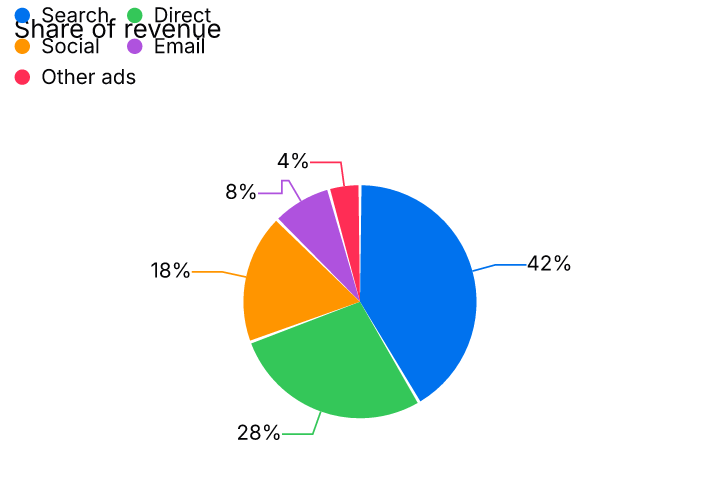

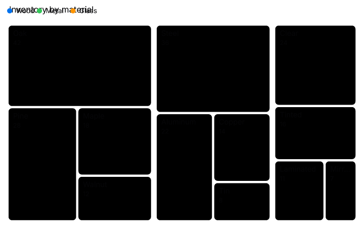

### 2. Axis offset ±80 does not grow the margin (311)

The offset slider runs from -80 to 80. Positive moves the baseline away from the plot. The tick and title move, and the margin does not, so "Signups" and the outer ticks leave the frame. `cartesian.ts` adds `axis.offset` to the label coordinate and not to `padding()`.

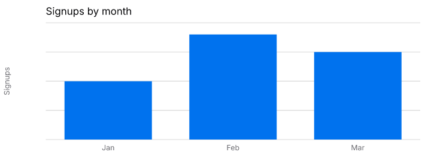

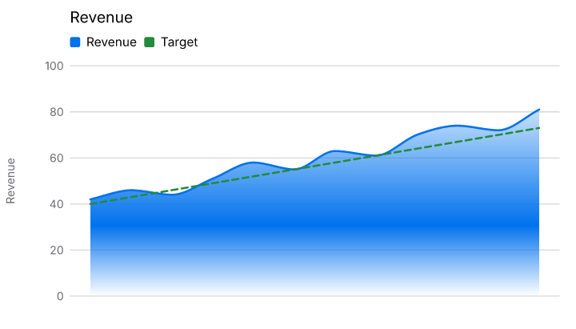

Contrast of a tick that lands on a bar because of this offset is in bucket 2, not here.

### 3. 240px frame, often with a side legend (229)

`size.width` `"240"` and the pair that sets width 240, height 160, and `legend.position` right. The legend, the "today" tag, and the right edge of the line share one column. 240 and 1200 are sizes the sweep treats as ordinary, and a 240px chart with a side legend was called out as a real bug.

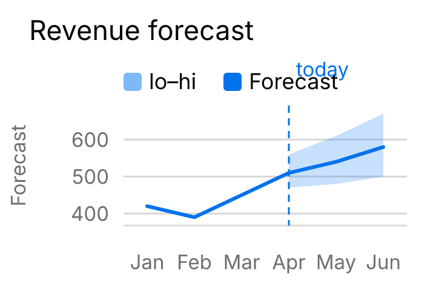

### 4. Axis position left, top, or right (208)

`axes.x.position`, `axes.y.position`, and `axes.y2.position` move the axis to another edge and leave the labels outside, or on top of the other axis. Same margin code as the offset group. Fix them together.

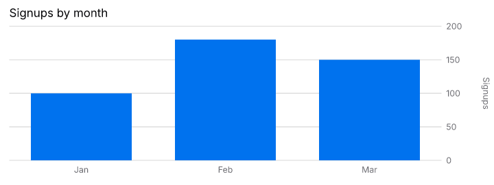

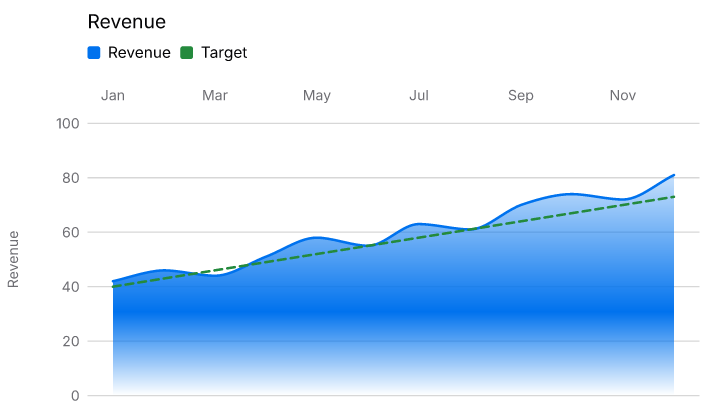

### 5. Other mark options (104)

What is left after the groups above: `mark.labelPosition`, `mark.labels`, sort order, heatmap `mark.layout` `"grid"`, `mark.weeks` 1, polar start/end angle. Each is a real option at a normal value. They are spread across heatmap, polar, and cartesian label placement, so this is the loose end of the layout work, not one function.

### 6. Right-to-left (78)

`layout.direction` `"rtl"` mirrors the chart and the labels keep a left-side anchor, so they leave the frame. `cartesian.ts` already has an `rtl` flag for the title. The tick and axis-title anchors do not follow it.

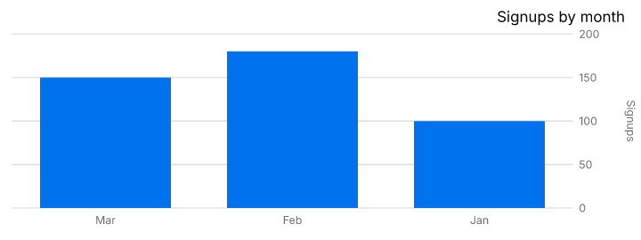

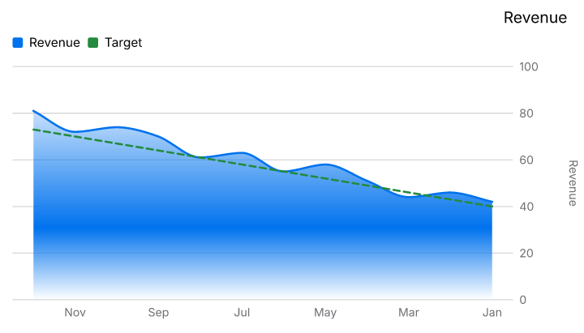

### 7. Y-axis title rotation (42)

The slider is -360 to 360. Setting it to 0 (horizontal) or to ±360 puts "Signups" outside the frame. The default -90° title is fine. Size S: give the horizontal title a width in the left margin.

### 8. Shipped examples that already collide (29)

These fail with no option changed.

- Sunburst: slice names overlap each other and leave the circle (`sunburst.ts`).
- Map points: city names and the size legend leave the frame (`packages/geo`).
- Venn, choropleth percent labels, one streamgraph date, one tree label.

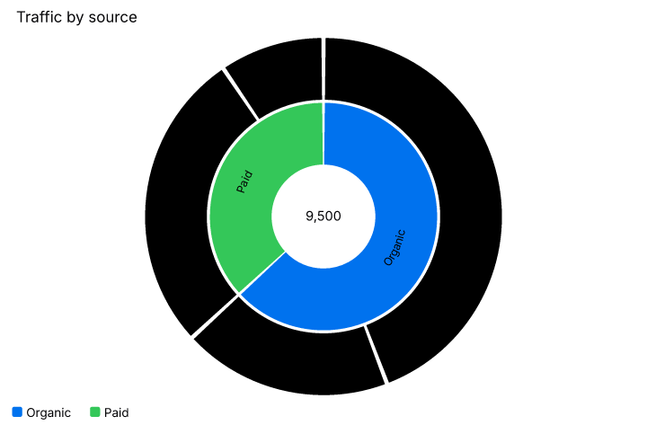

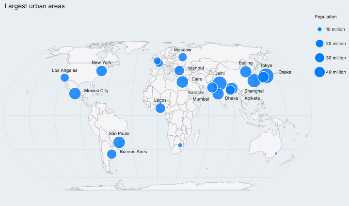

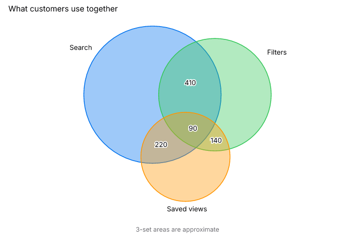

### 9. `legend.maxRows` 1 (21)

One row plus the pager sits on the title or the next legend item. `legend.ts`.

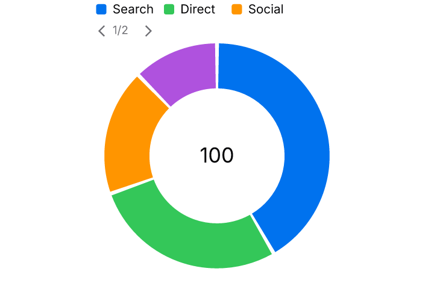

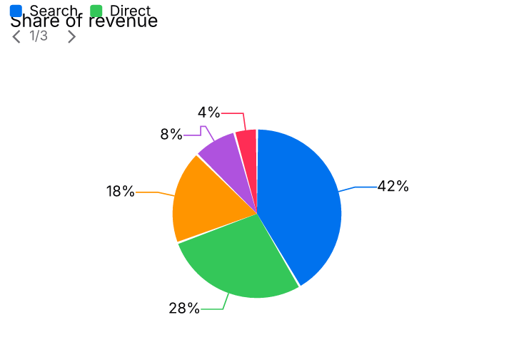

### 10. Dark-scheme annotation ink (9)

On the default area-range, "today" is 3.92:1 on `#0c0c0c` in the dark scheme. The strip callouts ("ChartKit", "94", the comparison line) use that same ink. Light-scheme text is fine. The label is not using a dark-scheme color that clears 4.5:1.

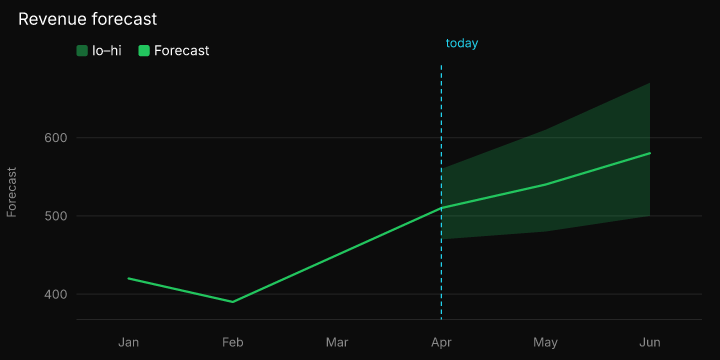

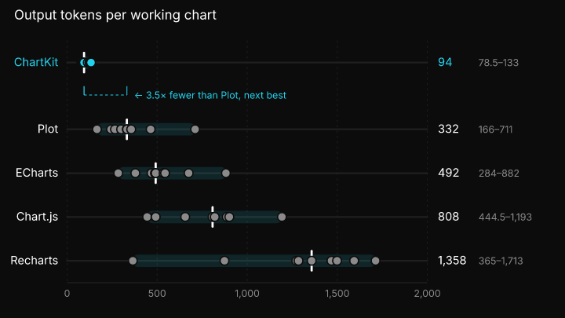

## Bucket 2. The test should change

The picture is ugly because the sweep asked for something Todd's rules already allow: a long label, a spec-set size, or a check that scores the wrong background. ChartKit does not shorten or rewrite labels. Fitting text is the builder's job. Spec-set sizes win.

| Group | Keys | Rule to add | README line |
| --- | ---: | --- | --- |
| Long formatted labels | 435 | `text-outside`, `text-overlap`, `text-clipped`, and `mark-outside` are informational when the varied option is a format, decimals, prefix, or suffix | A format the spec asked for is not a layout failure when the text does not fit. |
| Font size 32 | 417 | `theme.tokens.fontSize` of 24 or more is informational for text checks | A spec-set font size wins. Overlap at the top of the font slider is informational. |
| Stress values on the other checks | 286 | The existing stress rule (string longer than 48, number at or beyond 10,000, size `"0"` / `"10000"`) also covers `mark-outside`, `contrast`, `text-clipped`, and `render-time` | Stress inputs are informational on every check, not only the two text checks. |
| Tick scored on a bar | 142 | Tick and axis labels are scored against the page, not against a mark they cross | A tick that crosses a bar is scored against the page. |
| Sunburst text on a path | 84 | Contrast for `<textPath>` uses the slice fill, or is skipped | A sunburst label is scored against its slice, not the page behind the path. |
| Nominal axis shows the raw timestamp | 42 | Overlap from a nominal axis whose cells are long ISO strings is informational | A nominal axis shows the cell text unchanged. A long timestamp that does not fit is informational. |
| Width 10,000 raster | 2 | A raster whose bitmap height collapses to zero is informational | `size.width` 10000 can make the bitmap height zero. That raster failure is informational. |

### Long formatted labels (435)

Datetime, currency, percent, and `decimals: 1000000` (clamped to 20 digits) produce "Jan 1, 1970, 12:00 AM" or `120.00000000000000000000`. The chart printed the format it was given. It must not shorten it.

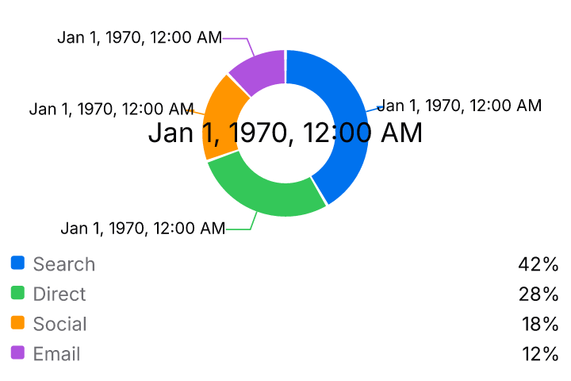

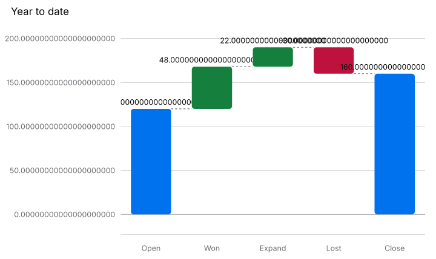

### Font size 32 (417)

The font slider allows 32. Titles and ticks then overlap or leave the frame. That is the size the spec set.

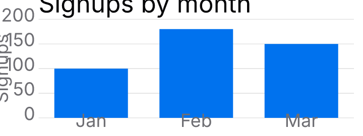

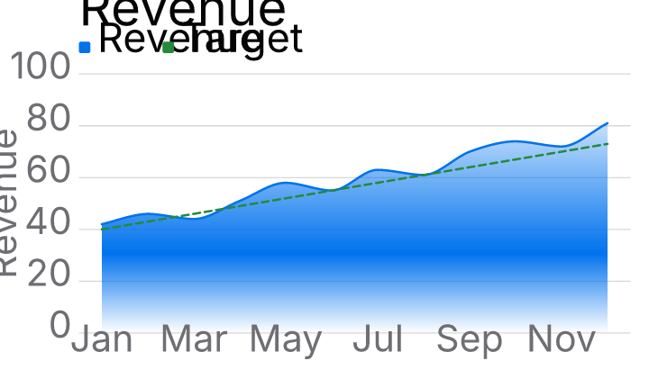

### Stress values on the other checks (286)

The long "Northstar…" prefix and suffix, `pointSize` / `innerRadius` / `offset` of 1,000,000, and the one slow candlestick (`encoding.x.scale.padding.max`, 1,782 ms) are the same stress inputs #130 already ignores for text-outside and text-overlap. `mark-outside` still fails them. Most of the old mark-outside allowlist is this group, not a realistic chart.

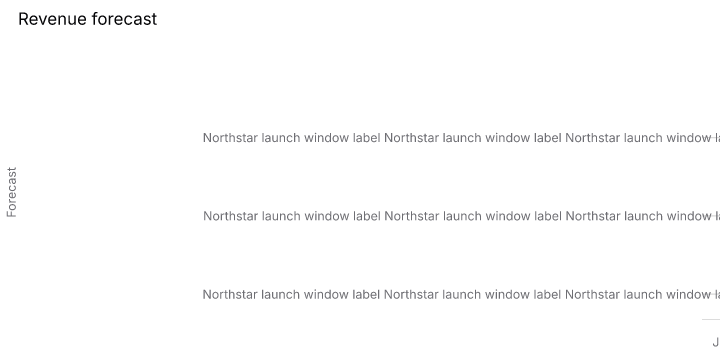

### Tick scored on a bar (142)

`axes.*.offset` of -80, a log y scale, or `scale.zero: false` moves the baseline into the plot. The category tick or the "50" sits on the blue bar, and the check scores the bar as the background (about 1.1:1). The offset did what it says. The tick's job is to be read against the page.

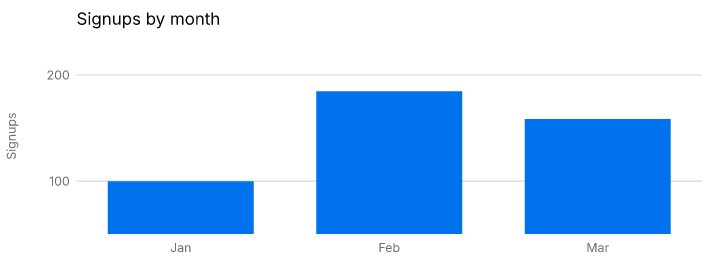

### Sunburst text on a path (84)

Slice names are `<textPath>` in black or near-black. The check's box is not the arc, so it scores them against `#0c0c0c` at about 1.1:1. The glyph is on the slice.

### Nominal axis shows the raw timestamp (42)

Setting `encoding.x.type` to nominal or ordinal on a candlestick prints `2024-06-03T00:00:00Z` on every candle. Those strings overlap. The chart is showing the cell. It must not rewrite it.

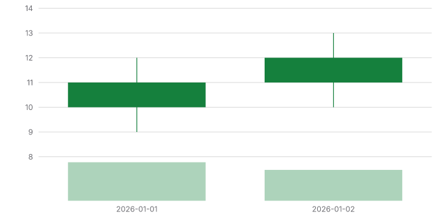

### Width 10,000 raster (2)

`sparkline` `12-sparkline` and `mini-area` `13-mini-area`, `size.width` `"10000"`. resvg reports a target size of zero. The size is one the spec set. The failure is the bitmap fit, not a thrown render. No picture: the raster is the failure.

## Bucket 3. Decisions for Todd

Code can implement any of these. The choice is the product.

### Positive `#15803d` and negative `#be123c`

Four allowlist keys use these exact colors (a candlestick and a gantt). The same pair is the Soft positive and negative tokens, so every chart that paints text on them or uses them as ink has the same problem. Measured with the current text token `#050507`:

| Use | Ratio | 4.5:1 |
| --- | ---: | --- |
| Text on `#15803d` | 4.06 | fails |
| `#15803d` as ink on white | 5.02 | passes |
| White on `#15803d` | 4.56 | passes |
| Text on `#be123c` | 3.24 | fails |
| `#be123c` as ink on white | 6.29 | passes |
| White on `#be123c` | 6.70 | passes |

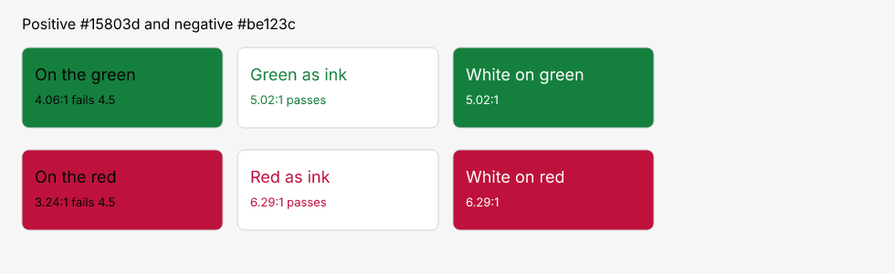

Options:

1. **Keep one color for both jobs.** Green ink on white passes. Text on the green fails. Red is the same shape, worse as a fill. No code. The four keys stay.
2. **Darken the fills until text on them passes.** Text-on-fill gets to 4.5. The same darker green and red, used as ink on white, get harder to read or fall under 4.5. One token cannot win both tests.
3. **Split the token.** `positive` / `negative` stay the ink on white (`#15803d`, `#be123c`). New fill tokens are darker, and labels on a delta pill or a status bar use those. Both jobs pass. This is a token rename and a pass through the few charts that paint text on these colors (gantt, candlestick, KPI delta).

### Presets other than the tuned Soft ramp (1,853)

`theme` set to another name. The large ones are neon, obsidian, emerald, orchid, and latte, a few hundred keys each. Mustard, refined, sunset, editorial, kite, midnight, and the smaller names are under 20 each. Soft and auto still have one key each. These palettes were not part of the #130 retune. Text on their fills, and their ink on the page, misses 4.5:1 in the same way Soft did before that change.

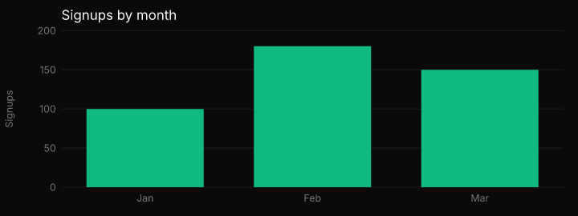

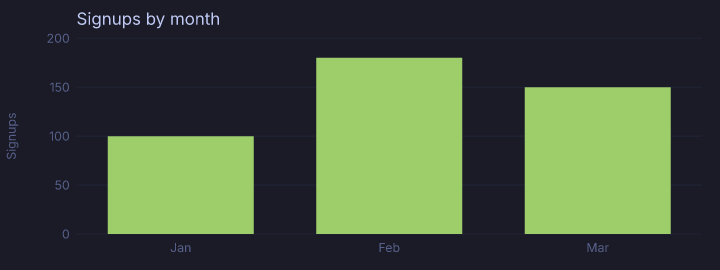

Options:

1. **Leave them.** Soft is the default. The other names stay as designed, and their contrast keys stay allowlisted.
2. **Retune every preset the way Soft was retuned.** Darken each fill until the text token clears 4.5, and keep a brighter line color for strokes on the page. Largest visual change. Clears most of these 1,853 keys.
3. **Retune only the five big ones** (neon, obsidian, emerald, orchid, latte) and leave the long tail allowlisted until someone uses that theme.

### When the spec sets the color (1,935)

`theme.tokens.background`, `theme.tokens.text`, `theme.tokens.muted`, `theme.tokens.surface`, and `theme.brand`, set to `#111111` or `#f5f5f7`. The chart paints that color. Ink and background then match, and contrast is about 1:1. This is the builder choosing both sides.

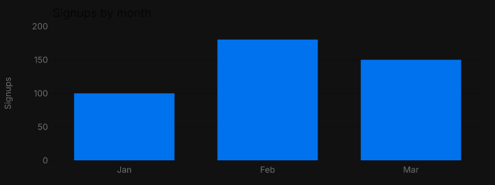

Options:

1. **Honor the spec.** The keys stay failures, or they become informational because the spec set the color. The chart does not invent a second color.
2. **Recolor the ink when a token override breaks 4.5:1.** Background `#111111` would flip the text to a light ink. The spec's text token, if they also set one, has to win or lose by a documented order.
3. **Warn in `validate` (a CK4xxx design code) and do not fail the render sweep.** The chart still draws the requested colors. The builder sees the warning. The sweep treats an explicit text or background token as informational.

### Large or bold text at 3:1

The check already does this. Body text needs 4.5:1. Text at 18px or larger, or weight 700, needs 3:1. That is the WCAG large-text rule. The picture is two grays: 16px regular at 3.54:1 fails, 24px bold at 3.32:1 passes.

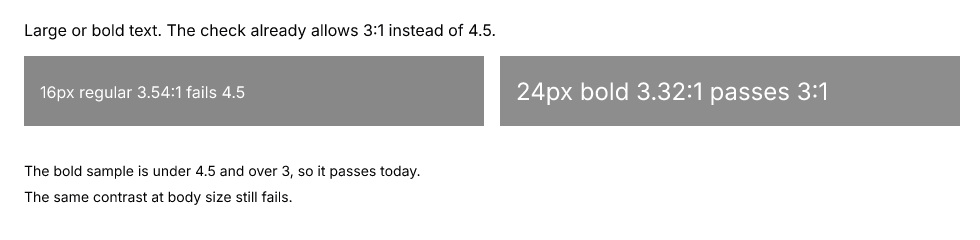

Options:

1. **Keep 3:1 for large or bold.** What the sweep does today.
2. **Use 4.5:1 for every text size.** The bold sample would fail. More keys, stricter than WCAG for headlines.
3. **Use 3:1 only for text that is both large and bold.** 18px regular would go back to 4.5. Stricter than today, looser than option 2.

### The #130 Soft change

Current Soft: text `#050507`, first fill `#0072ee`. The original palette was text `#1d1d1f`, fill `#007aff`.

| Pair | Ratio |
| --- | ---: |
| `#050507` on `#0072ee` (current text on current fill) | 4.50 |
| `#0072ee` on white (current blue used as ink) | 4.52 |
| `#1d1d1f` on `#007aff` (original text on original fill) | 4.19 |
| `#007aff` on white (original blue used as ink) | 4.02 |
| `#050507` on `#007aff` (darker text on the original fill) | 5.07 |

The current pair passes both jobs: text on the fill, and the blue used as ink on white. Putting only the text darker, and keeping `#007aff`, passes text-on-fill (5.07) and fails blue-as-ink on white (4.02).

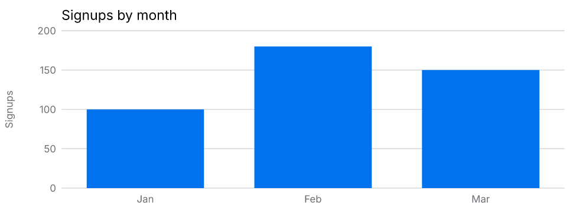

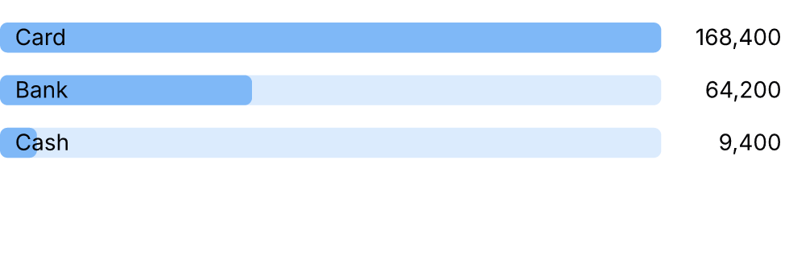

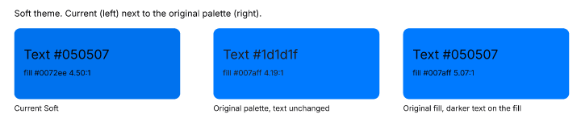

Options:

1. **Keep #130.** Text `#050507`, fills darkened, lines left bright. Both the fill job and the ink-on-white job pass for the first blue. This is what shipped.
2. **Restore the original palette and only darken text that sits on a fill.** Bars go back to `#007aff`. Labels on a bar use `#050507`. Axis and title text stay `#1d1d1f`. Text on a bar passes. Any label that is itself `#007aff` on white goes back to 4.02:1.
3. **Restore the original palette and accept the misses.** Text `#1d1d1f` on `#007aff` is 4.19:1, and `#007aff` on white is 4.02:1. Closest to the pre-#130 look. Those keys come back.

## Suggested order of work

Fix bucket 1 in the order in the table. Groups 2, 3, and 4 are one margin change in `cartesian.ts`. Group 1 is the pie, donut, treemap, and radar legend. Then the bucket 2 rule changes, which are harness-only and drop about 1,408 keys without moving a chart. Bucket 3 waits on Todd.
